import Cite from '../../components/Cite.astro';
import Citation from '../../components/Citation.astro';
import References from '../../components/References.astro';
import GrpcTimeline from '../../components/GrpcTimeline.astro';

## Service-to-service calls with gRPC

Services call each other to request data or delegate work. **gRPC** uses typed contracts, typically Protocol Buffers and HTTP/2, for efficient communication across languages.

For example, an online shop's **Order service** asks its **Inventory service** if an item is in stock.

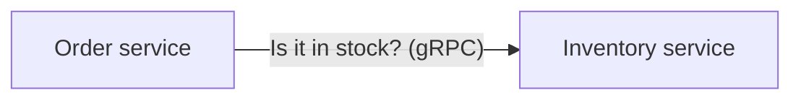

### Local procedure call vs. Remote procedure call

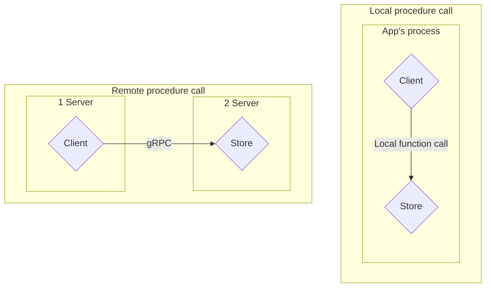

Source: recreated from the supplied video screenshot <Cite id="coding-gopher-grpc" author="The Coding Gopher" year="n.d." />.

A **local call** runs within the application's process. A **remote call** crosses a process boundary and, in this example, a network connection between two servers. gRPC makes that call look like a method invocation, but serialization, network latency, and connection failures still apply.

### Order and payment: local call vs. RPC

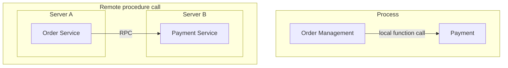

Source: recreated from the supplied video screenshot <Cite id="coding-gopher-grpc" author="The Coding Gopher" year="n.d." />.

The local version calls payment code within the same process. The distributed version separates order and payment into services, with an RPC crossing the boundary.

### Client and server stubs

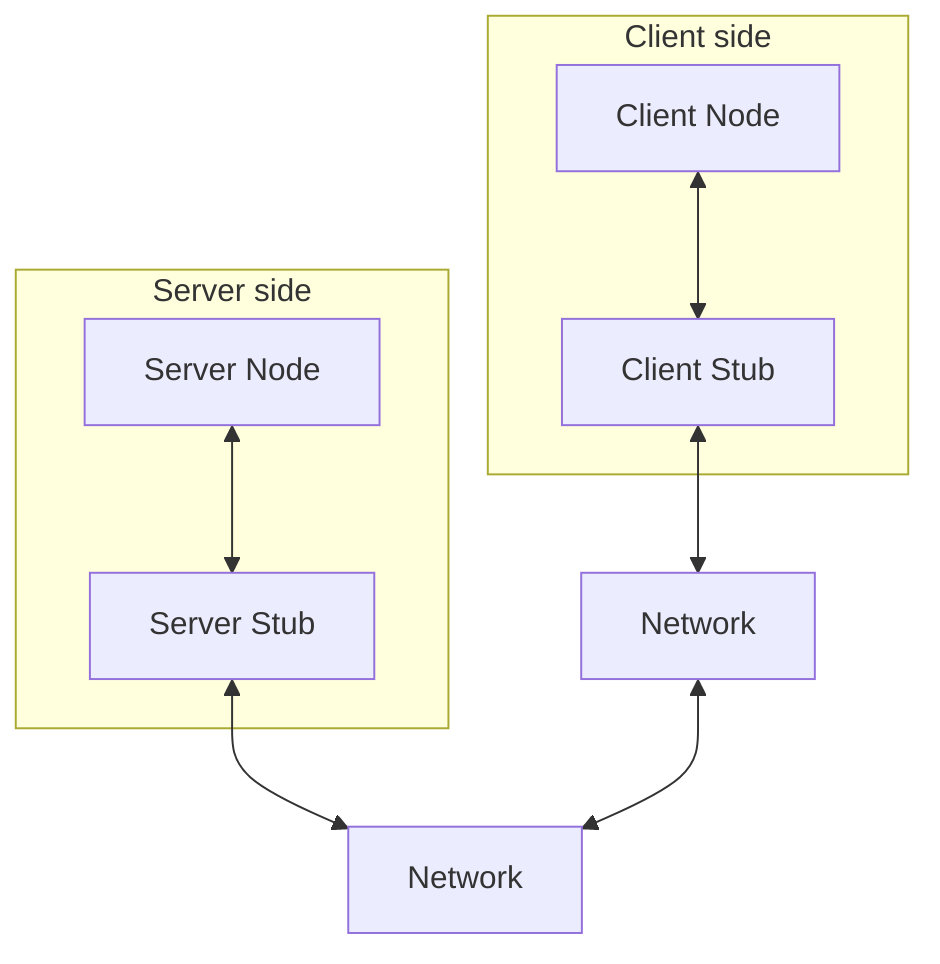

Source: recreated from the supplied video screenshot <Cite id="coding-gopher-grpc" author="The Coding Gopher" year="n.d." />.

The **Client Node** is your calling application; the **Server Node** is the service implementation. The client stub and gRPC runtime send the request across the network. The **Server Stub** represents the server-side bindings that route it to your handler. The reply travels back along the same path. The two Network boxes represent each side's network connection, not two extra services.

### RPC call: serialization and transport

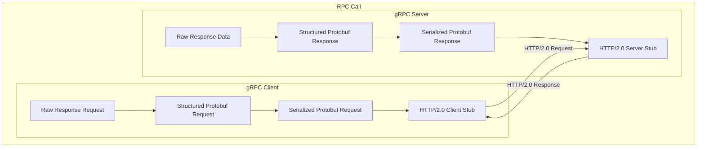

Source: recreated from the supplied video screenshot <Cite id="coding-gopher-grpc" author="The Coding Gopher" year="n.d." />.

The screenshot's **Raw Response Request** label refers to the client's raw request data. Each side converts its outgoing message into Protobuf bytes; the gRPC runtime transports those bytes over HTTP/2. The receiving side deserializes them before invoking the server handler or returning the reply to the client. The diagram focuses on outgoing serialization, so it omits those receiving steps.

### About gRPC

It's basically an alternative to REST or GraphQL.

Begs the questionwhen to use it. It's typicallyt used as a servioce to service commmiunication, you are unlikely to use gRPC to talk to your front-end. it's very efficient for back-end services talking to each other.

| Use case | Typical choice | Why |
| --- | --- | --- |
| Public / partner / third-party APIs | REST (JSON over HTTP) | Universal client support, easy debugging (curl, browser tools, Postman), HTTP caching/CDNs, no generated stubs required |
| Browser / frontend → backend | REST (or GraphQL) | Browsers can’t speak native gRPC (needs gRPC-Web + proxy or alternatives like Connect) |
| Internal service-to-service (microservices) | gRPC (often) | Smaller payloads (Protobuf), lower latency, strong typed contracts, polyglot code generation, built-in streaming |
| High-throughput / real-time / streaming | gRPC preferred | Performance and streaming advantages compound at scale |

| Technology | Approach | Typical data format | Common uses |
| --- | --- | --- | --- |
| **gRPC** | Remote procedure calls (RPC), usually over HTTP/2 | Protocol Buffers by default | Typed service-to-service calls, streaming |
| **REST over HTTP** | Resources accessed through HTTP methods such as GET and POST | Usually JSON | Public APIs, web and mobile applications |
| **GraphQL** | Clients request specific fields through a typed query language | Usually JSON | Flexible data fetching for frontends |
| **JSON-RPC** | Named remote method calls | JSON | Simple RPC APIs, developer tools |
| **Apache Thrift** | RPC framework with generated client/server code | Multiple encodings, commonly binary | Cross-language backend services |
| **SOAP** | Structured messages with formal service contracts | XML | Enterprise and legacy integrations |
| **Connect RPC** | Typed RPC over HTTP, compatible with gRPC | Protocol Buffers or JSON | Browser-friendly RPC and backend services |

### RPC and gRPC timeline

The milestones below are transcribed from the video's timeline, with its dates reproduced as shown.

<GrpcTimeline />

Source: recreated from the supplied video screenshot <Cite id="coding-gopher-grpc" author="The Coding Gopher" year="n.d." />.

**Historical clarification:** the screenshot's dates are not all accurate. gRPC was already open source in 2015 <Cite id="grpc-about" author="gRPC" year="n.d." />; 2016 marks its 1.0 release <Cite id="grpc-1-0" author="Talwar, V." year="2016" />. HTTP/2 was part of its original design <Cite id="grpc-principles" author="gRPC" year="n.d." />, not a 2018 addition.

### From .proto to application code

**PB** means **Protocol Buffers**. The diagram shows how a `.proto` definition becomes code your application can use to encode and decode messages.

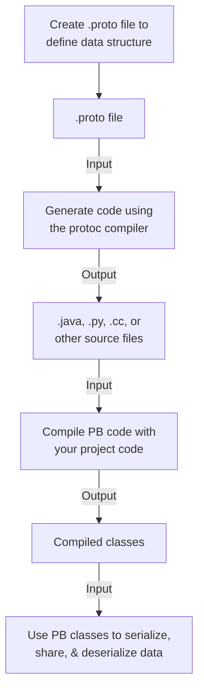

Source: recreated from the supplied video screenshot <Cite id="coding-gopher-grpc" author="The Coding Gopher" year="n.d." />.

For gRPC, compiler plugins also generate client stubs and server interfaces. The compilation step depends on the language: Go and Java compile the generated code with the application; Python imports the generated `.py` modules without a separate manual compilation step.

### Code generation, serialization, and deserialization

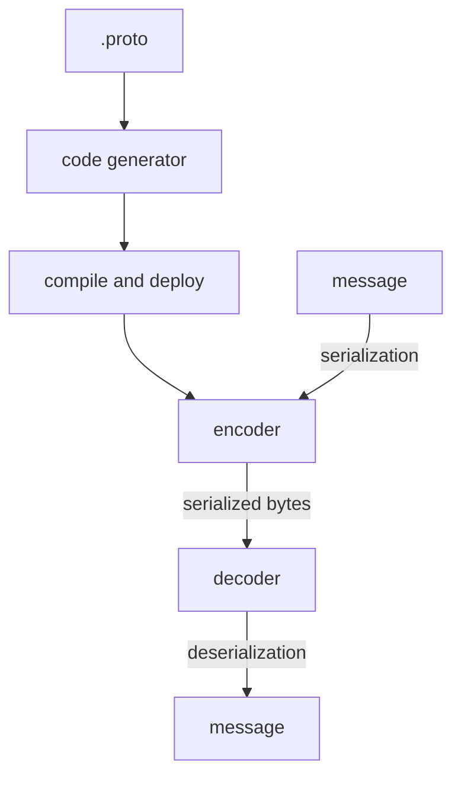

Source: recreated from the supplied video screenshot <Cite id="coding-gopher-grpc" author="The Coding Gopher" year="n.d." />.

Code generation happens before the application runs. At runtime, the encoder converts a message into bytes, and the decoder reconstructs a message from those bytes. Both communicating applications need the appropriate generated code and runtime support.

### Define, compile, generate, implement

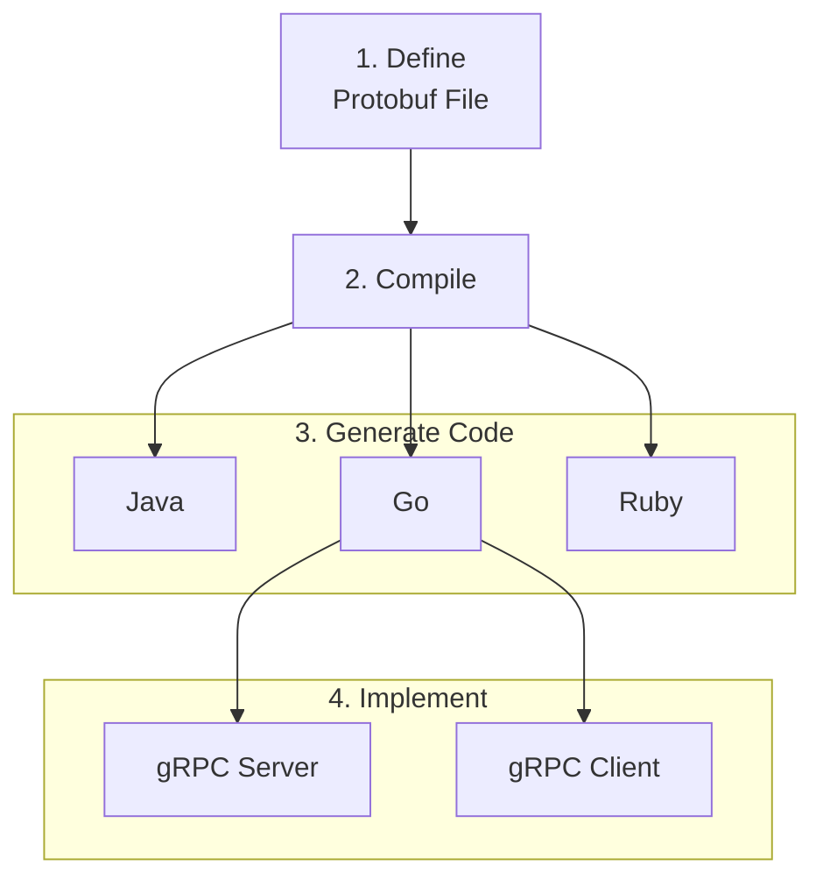

Source: recreated from the supplied video screenshot <Cite id="coding-gopher-grpc" author="The Coding Gopher" year="n.d." />.

Here, **Compile** means running `protoc` with the appropriate language plugins to generate source code, not building the final application. Go is the example connected to the client and server; the same workflow applies to Java, Ruby, and other supported languages.

### Language and platform-neutral

```proto
syntax = "proto3";

message Person {
  string first_name = 1;
  string last_name = 2;
  int32 age = 3;
  float weight = 4;
  repeated string addresses = 5;

  enum Gender {
    Unknown = 0;
    FeMale = 1;
    Male = 2;
  }

  Gender gender = 6;
}
```

Source: transcribed from the supplied video screenshot <Cite id="coding-gopher-grpc" author="The Coding Gopher" year="n.d." />.

The screenshot labels the parts of `string first_name = 1;` as **field type** (`string`), **field name** (`first_name`), and **field tag** (`1`). The tag identifies the field in the binary encoding; it is not the field's default value. `syntax = "proto3";` selects the Protobuf syntax version, `message Person` defines a message type, and `repeated` allows multiple values.

### A calculator contract

`add_service.proto`:

```proto
syntax = "proto3";

package calculator;

// The request message containing the two integers.
message AddRequest {
  int32 a = 1;
  int32 b = 2;
}

// The response message containing the result.
message AddResponse {
  int32 result = 1;
}

// The calculator service definition.
service AddService {
  rpc Add(AddRequest) returns (AddResponse);
}
```

Source: transcribed from the supplied video screenshot <Cite id="coding-gopher-grpc" author="The Coding Gopher" year="n.d." />.

### The pattern

```text
define service contract: RPC(request) -> response
generate message types, client stub, and server interface

server implements RPC(request):
  validate request
  return response

client startup:
  open secure channel
  create stub using channel

handle each request:
  call stub.RPC(request, deadline)
  handle RPC errors separately from a normal response
  use response

shutdown: close channel
```

## Connecting gRPC to other applications

### REST clients through a reverse proxy

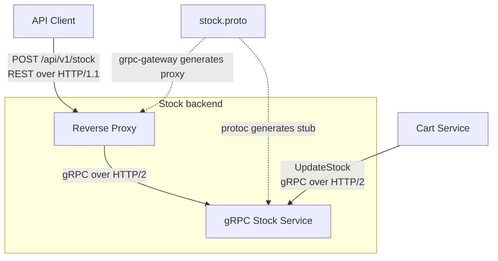

The REST request shown in the screenshot:

```http
POST /api/v1/stock HTTP/1.1
Content-Type: application/json

{"itemNumber": "item4", "quantity": 50}
```

The Cart Service calls the same backend directly through gRPC:

```text
UpdateStock
  itemNumber: "item4"
  quantity: 50
```

Source: recreated and transcribed from the supplied video screenshot <Cite id="coding-gopher-grpc" author="The Coding Gopher" year="n.d." />.

The proxy translates between REST/JSON and gRPC. `grpc-gateway` generates proxy code from an appropriately configured service definition; it does not turn every `.proto` file into a REST API automatically.

### Browser access with gRPC-Web

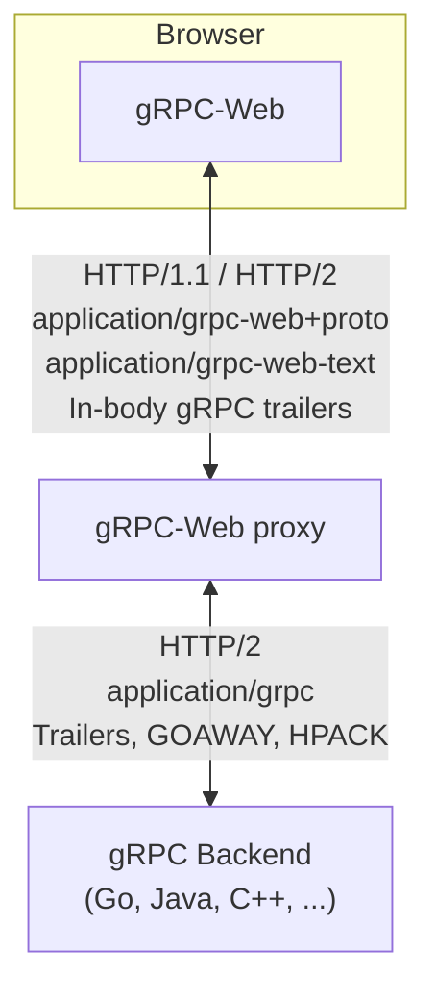

Source: recreated from the supplied video screenshot <Cite id="coding-gopher-grpc" author="The Coding Gopher" year="n.d." />.

The browser uses gRPC-Web rather than native gRPC. The proxy adapts between the browser-facing protocol and the backend's HTTP/2 gRPC connection.

### A polyglot microservices architecture

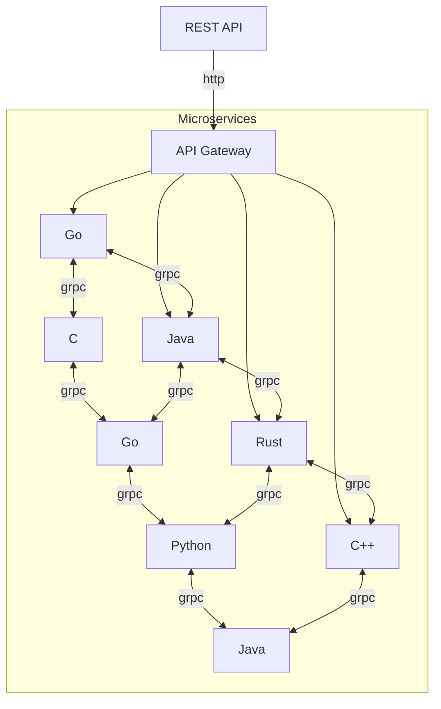

Source: recreated from the supplied video screenshot <Cite id="coding-gopher-grpc" author="The Coding Gopher" year="n.d." />.

An API gateway provides the external HTTP entry point, while internal services communicate through gRPC across language boundaries. The connections illustrate one possible architecture, not a requirement that every service call every other service.

## Code snippets: Hello World

The classic gRPC Hello World is a **Greeter** service: a client sends a name to `SayHello`, and the server replies with a greeting. These examples share one contract, so a client in any of the three languages can call a server in another.

Each example runs independently on `localhost:50051`. Start one server, then run a client in another terminal. Connections are unencrypted for this local demo only; use TLS outside local development.

### How the code fits together

Read this diagram from top to bottom. You write the client call and the server's greeting logic; gRPC handles sending and receiving the messages.

A **stub** is a local representative of the remote service, generated from your `.proto` file. Calling its `SayHello` method looks like calling an ordinary function, but the stub works with the gRPC runtime to encode your request, send it to the server, and decode the reply. You use the returned message without writing the networking code yourself. Unlike a local function call, it can fail because the server is unreachable or the deadline expires.

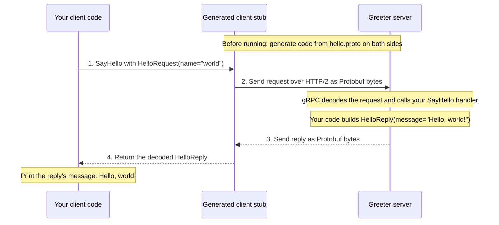

In the snippets, the stub is `NewGreeterClient` in **Go**, `GreeterStub` in **Python**, or `newBlockingStub` in **Java**. The server handler is `SayHello` in Go/Python and `sayHello` in Java. The `.proto` file is the shared agreement, not a separate service running between them.

### Shared contract

Save as `hello.proto`:

```proto
syntax = "proto3";

package hello;
option go_package = "example.com/hello/hellopb";
option java_package = "hello";
option java_multiple_files = true;

service Greeter {
  rpc SayHello(HelloRequest) returns (HelloReply);
}

message HelloRequest {
  string name = 1;
}

message HelloReply {
  string message = 1;
}
```

<div data-code-examples>

<div data-code-switcher role="group" aria-label="Hello World example language" hidden>
  <button type="button" value="go" aria-controls="hello-go" aria-pressed="true">Go</button>
  <button type="button" value="python" aria-controls="hello-python" aria-pressed="false">Python</button>
  <button type="button" value="java" aria-controls="hello-java" aria-pressed="false">Java</button>
</div>

<div id="hello-go" data-code-example="go">

### Go

With Go and `protoc` installed, generate the code from `hello.proto`:

```sh
go mod init example.com/hello
go get google.golang.org/grpc google.golang.org/protobuf
go install google.golang.org/protobuf/cmd/protoc-gen-go@latest
go install google.golang.org/grpc/cmd/protoc-gen-go-grpc@latest
export PATH="$(go env GOPATH)/bin:$PATH"
protoc --go_out=. --go_opt=module=example.com/hello \
  --go-grpc_out=. --go-grpc_opt=module=example.com/hello hello.proto
```

**Server** (`cmd/server/main.go`):

```go
package main

import (
    "context"
    "log"
    "net"

    pb "example.com/hello/hellopb"
    "google.golang.org/grpc"
)

type greeter struct {
    pb.UnimplementedGreeterServer
}

func (greeter) SayHello(_ context.Context, req *pb.HelloRequest) (*pb.HelloReply, error) {
    return &pb.HelloReply{Message: "Hello, " + req.GetName() + "!"}, nil
}

func main() {
    listener, err := net.Listen("tcp", "127.0.0.1:50051")
    if err != nil {
        log.Fatal(err)
    }
    server := grpc.NewServer()
    pb.RegisterGreeterServer(server, greeter{})
    log.Fatal(server.Serve(listener))
}
```

**Client** (`cmd/client/main.go`):

```go
package main

import (
    "context"
    "fmt"
    "log"
    "time"

    pb "example.com/hello/hellopb"
    "google.golang.org/grpc"
    "google.golang.org/grpc/credentials/insecure"
)

func main() {
    conn, err := grpc.NewClient("localhost:50051",
        grpc.WithTransportCredentials(insecure.NewCredentials()))
    if err != nil {
        log.Fatal(err)
    }
    defer conn.Close()

    ctx, cancel := context.WithTimeout(context.Background(), time.Second)
    defer cancel()
    reply, err := pb.NewGreeterClient(conn).SayHello(ctx, &pb.HelloRequest{Name: "world"})
    if err != nil {
        log.Fatal(err)
    }
    fmt.Println(reply.GetMessage())
}
```

Run `go run ./cmd/server`, then `go run ./cmd/client`.

</div>

<div id="hello-python" data-code-example="python">

### Python

With Python installed, generate the code beside `hello.proto`:

```sh
python -m venv .venv
```

Activate the environment (`source .venv/bin/activate` on macOS/Linux, `.venv\Scripts\activate` in Windows Command Prompt), then run:

```sh
python -m pip install grpcio grpcio-tools
python -m grpc_tools.protoc -I. --python_out=. --grpc_python_out=. hello.proto
```

**Server** (`server.py`):

```python
from concurrent import futures

import grpc
import hello_pb2 as pb
import hello_pb2_grpc as rpc


class Greeter(rpc.GreeterServicer):
    def SayHello(self, request, context):
        return pb.HelloReply(message=f"Hello, {request.name}!")


server = grpc.server(futures.ThreadPoolExecutor(max_workers=2))
rpc.add_GreeterServicer_to_server(Greeter(), server)
server.add_insecure_port("127.0.0.1:50051")
server.start()
server.wait_for_termination()
```

**Client** (`client.py`):

```python
import grpc
import hello_pb2 as pb
import hello_pb2_grpc as rpc

with grpc.insecure_channel("localhost:50051") as channel:
    reply = rpc.GreeterStub(channel).SayHello(
        pb.HelloRequest(name="world"), timeout=1
    )
    print(reply.message)
```

Run `python server.py`, then `python client.py` with the environment activated in both terminals. RPC errors propagate as exceptions.

</div>

<div id="hello-java" data-code-example="java">

### Java

With JDK 17 and Gradle installed, put `hello.proto` in `src/main/proto/`. Gradle downloads the compiler and generates the Java code.

**Build configuration** (`build.gradle`):

```groovy
plugins {
    id 'application'
    id 'com.google.protobuf' version '0.9.4'
}

repositories {
    mavenCentral()
}

def grpcVersion = '1.68.1'

dependencies {
    implementation "io.grpc:grpc-netty-shaded:$grpcVersion"
    implementation "io.grpc:grpc-protobuf:$grpcVersion"
    implementation "io.grpc:grpc-stub:$grpcVersion"
    compileOnly 'javax.annotation:javax.annotation-api:1.3.2'
}

protobuf {
    protoc { artifact = 'com.google.protobuf:protoc:3.25.5' }
    plugins {
        grpc { artifact = "io.grpc:protoc-gen-grpc-java:$grpcVersion" }
    }
    generateProtoTasks {
        all().each { task -> task.plugins { grpc {} } }
    }
}

application {
    mainClass = project.findProperty('mainClass') ?: 'HelloServer'
}
```

**Server** (`src/main/java/HelloServer.java`):

```java
import hello.GreeterGrpc;
import hello.HelloReply;
import hello.HelloRequest;
import io.grpc.netty.shaded.io.grpc.netty.NettyServerBuilder;
import io.grpc.stub.StreamObserver;
import java.net.InetSocketAddress;

public class HelloServer {
    public static void main(String[] args) throws Exception {
        var server = NettyServerBuilder
            .forAddress(new InetSocketAddress("127.0.0.1", 50051))
            .addService(new GreeterGrpc.GreeterImplBase() {
                @Override
                public void sayHello(HelloRequest request,
                        StreamObserver<HelloReply> response) {
                    response.onNext(HelloReply.newBuilder()
                        .setMessage("Hello, " + request.getName() + "!")
                        .build());
                    response.onCompleted();
                }
            })
            .build()
            .start();
        server.awaitTermination();
    }
}
```

**Client** (`src/main/java/HelloClient.java`):

```java
import hello.GreeterGrpc;
import hello.HelloRequest;
import io.grpc.Grpc;
import io.grpc.InsecureChannelCredentials;
import java.util.concurrent.TimeUnit;

public class HelloClient {
    public static void main(String[] args) throws Exception {
        var channel = Grpc.newChannelBuilder("localhost:50051",
            InsecureChannelCredentials.create()).build();
        try {
            var reply = GreeterGrpc.newBlockingStub(channel)
                .withDeadlineAfter(1, TimeUnit.SECONDS)
                .sayHello(HelloRequest.newBuilder().setName("world").build());
            System.out.println(reply.getMessage());
        } finally {
            channel.shutdownNow().awaitTermination(5, TimeUnit.SECONDS);
        }
    }
}
```

Run `gradle run`, then `gradle run -PmainClass=HelloClient`.

</div>

</div>

Each client prints:

```text
Hello, world!
```

## Implementation

Both examples use generated gRPC code, TLS and a deadline. The Order code shows only its outbound call; a real service should also propagate incoming cancellation and deadlines. The stock data is illustrative: production systems should authenticate callers (for example, with mTLS), use a persistent store and reserve stock atomically.

First, save this shared contract as `inventory.proto`:

```proto
syntax = "proto3";

package shop.inventory.v1;
option go_package = "example.com/shop/inventorypb";

service Inventory {
  rpc CheckStock(CheckStockRequest) returns (CheckStockResponse);
}

message CheckStockRequest {
  string sku = 1;
  int32 quantity = 2;
}

message CheckStockResponse {
  bool in_stock = 1;
}
```

Provide a TLS certificate and private key for the Inventory service as `TLS_CERT_FILE` and `TLS_KEY_FILE`. Set `CA_CERT_FILE` and `INVENTORY_ADDRESS` for the Order service; the address hostname must match the certificate.

<div data-code-examples>

<div data-code-switcher role="group" aria-label="Inventory example language" hidden>
  <button type="button" value="python" aria-controls="grpc-python" aria-pressed="true">Python</button>
  <button type="button" value="go" aria-controls="grpc-go" aria-pressed="false">Go</button>
</div>

<div id="grpc-python" data-code-example="python">

### Python

Install the tools and generate the client and server code:

```sh
python -m pip install grpcio grpcio-tools
python -m grpc_tools.protoc -I. --python_out=. --grpc_python_out=. inventory.proto
```

**Inventory service** (`inventory.py`):

```python
from concurrent import futures
import os
from pathlib import Path

import grpc
import inventory_pb2
import inventory_pb2_grpc


class Inventory(inventory_pb2_grpc.InventoryServicer):
    def CheckStock(self, request, context):
        if not request.sku or request.quantity <= 0:
            context.abort(grpc.StatusCode.INVALID_ARGUMENT, "SKU and positive quantity required")

        available = {"book": 10}.get(request.sku, 0)  # Example data only.
        return inventory_pb2.CheckStockResponse(in_stock=available >= request.quantity)


server = grpc.server(futures.ThreadPoolExecutor(max_workers=10))
inventory_pb2_grpc.add_InventoryServicer_to_server(Inventory(), server)
key = Path(os.environ["TLS_KEY_FILE"]).read_bytes()
cert = Path(os.environ["TLS_CERT_FILE"]).read_bytes()
server.add_secure_port("[::]:50051", grpc.ssl_server_credentials(((key, cert),)))
server.start()
server.wait_for_termination()
```

**Order service** (`order.py`):

```python
import os
from pathlib import Path

import grpc
import inventory_pb2
import inventory_pb2_grpc


class OrderService:
    def __init__(self):
        ca = Path(os.environ["CA_CERT_FILE"]).read_bytes()
        credentials = grpc.ssl_channel_credentials(root_certificates=ca)
        self.channel = grpc.secure_channel(os.environ["INVENTORY_ADDRESS"], credentials)
        self.inventory = inventory_pb2_grpc.InventoryStub(self.channel)

    def check_stock(self, sku, quantity):
        try:
            response = self.inventory.CheckStock(
                inventory_pb2.CheckStockRequest(sku=sku, quantity=quantity),
                timeout=1.0,
            )
        except grpc.RpcError as error:
            raise RuntimeError(f"Inventory RPC failed: {error.code().name}") from error
        return response.in_stock

    def close(self):
        self.channel.close()


if __name__ == "__main__":
    service = OrderService()  # Create once and reuse for requests.
    try:
        print("In stock:", service.check_stock("book", 1))
    finally:
        service.close()
```

Run `python inventory.py`, then `python order.py` in another terminal.

</div>

<div id="grpc-go" data-code-example="go">

### Go

Install `protoc` and its Go plugins, then generate the client and server code:

```sh
go mod init example.com/shop
go get google.golang.org/grpc google.golang.org/protobuf
go install google.golang.org/protobuf/cmd/protoc-gen-go@latest
go install google.golang.org/grpc/cmd/protoc-gen-go-grpc@latest
```

Add the Go binaries directory to your `PATH`, then run:

```sh
protoc -I . --go_out=. --go_opt=module=example.com/shop --go-grpc_out=. --go-grpc_opt=module=example.com/shop inventory.proto
```

**Inventory service** (`cmd/inventory/main.go`):

```go
package main

import (
    "context"
    "log"
    "net"
    "os"

    pb "example.com/shop/inventorypb"
    "google.golang.org/grpc"
    "google.golang.org/grpc/codes"
    "google.golang.org/grpc/credentials"
    "google.golang.org/grpc/status"
)

type inventoryServer struct {
    pb.UnimplementedInventoryServer
}

func (s *inventoryServer) CheckStock(ctx context.Context, req *pb.CheckStockRequest) (*pb.CheckStockResponse, error) {
    if req.GetSku() == "" || req.GetQuantity() <= 0 {
        return nil, status.Error(codes.InvalidArgument, "SKU and positive quantity required")
    }

    stock := map[string]int32{"book": 10} // Example data only.
    return &pb.CheckStockResponse{InStock: stock[req.GetSku()] >= req.GetQuantity()}, nil
}

func main() {
    creds, err := credentials.NewServerTLSFromFile(os.Getenv("TLS_CERT_FILE"), os.Getenv("TLS_KEY_FILE"))
    if err != nil {
        log.Fatal(err)
    }
    listener, err := net.Listen("tcp", ":50051")
    if err != nil {
        log.Fatal(err)
    }

    server := grpc.NewServer(grpc.Creds(creds))
    pb.RegisterInventoryServer(server, &inventoryServer{})
    if err := server.Serve(listener); err != nil {
        log.Fatal(err)
    }
}
```

**Order service** (`cmd/order/main.go`):

```go
package main

import (
    "context"
    "log"
    "os"
    "time"

    pb "example.com/shop/inventorypb"
    "google.golang.org/grpc"
    "google.golang.org/grpc/credentials"
)

func main() {
    creds, err := credentials.NewClientTLSFromFile(os.Getenv("CA_CERT_FILE"), "")
    if err != nil {
        log.Fatal(err)
    }
    conn, err := grpc.NewClient(os.Getenv("INVENTORY_ADDRESS"), grpc.WithTransportCredentials(creds))
    if err != nil {
        log.Fatal(err)
    }
    defer conn.Close()

    client := pb.NewInventoryClient(conn) // Create once and reuse for requests.
    ctx, cancel := context.WithTimeout(context.Background(), time.Second)
    defer cancel()
    result, err := client.CheckStock(ctx, &pb.CheckStockRequest{Sku: "book", Quantity: 1})
    if err != nil {
        log.Fatalf("Inventory RPC failed: %v", err)
    }
    log.Printf("In stock: %t", result.GetInStock())
}
```

Run `go run ./cmd/inventory`, then `go run ./cmd/order` in another terminal.

</div>

</div>

## Health checks for a gRPC server

```mermaid
flowchart TD
    subgraph HTTP["1. httpGet probe"]
        KubeletHTTP["kubelet"]
        subgraph ContainerHTTP["Container"]
            AppHTTP["gRPC server app"]
        end
        KubeletHTTP -->|"httpGet probe"| AppHTTP
    end

    subgraph TCP["2. tcpSocket probe"]
        KubeletTCP["kubelet"]
        subgraph ContainerTCP["Container"]
            AppTCP["gRPC server app"]
        end
        KubeletTCP -->|"tcpSocket probe"| AppTCP
    end

    subgraph Exec["3. exec probe"]
        KubeletExec["kubelet"]
        subgraph ContainerExec["Container"]
            TestClient["gRPC test client"]
            AppExec["gRPC server app"]
            TestClient -->|"custom grpc call"| AppExec
        end
        KubeletExec -->|"exec probe"| TestClient
    end
```

Source: recreated from the supplied video screenshot <Cite id="coding-gopher-grpc" author="The Coding Gopher" year="n.d." />.

| Probe shown | What it checks | Limitation or requirement |
| --- | --- | --- |
| `httpGet` | An HTTP health endpoint | The application needs to serve HTTP/1.1 as well as gRPC. |
| `tcpSocket` | Whether a TCP connection can be opened | An open port alone does not establish that the gRPC service is healthy. |
| `exec` | A gRPC call made by a test client inside the container | Include a client program in the container; kubelet executes it, and it calls the RPC you implement. |

These are the three approaches shown in the screenshot, not an exhaustive list. Kubernetes also supports native gRPC probes when the application implements the standard gRPC Health Checking Protocol <Cite id="kubernetes-probes" author="Kubernetes" year="n.d." />.


btw gRPC stands for Google RPC (Remote Procedure Call). RPC is a classic that's existed for years (think about your distributedf system class) 

This one is just a different take on it: others exist like webRPC

<References>
  <Citation
    id="ibm-grpc"
    author="IBM Technology"
    year="n.d."
    title="What is gRPC? (Remote Procedure Calls)"
    type="website"
    publisher="YouTube"
    url="https://www.youtube.com/watch?v=hVrwuMnCtok"
  />
  <Citation
    id="coding-gopher-grpc"
    author="The Coding Gopher"
    year="n.d."
    title="99% of Developers Don't Get gRPC"
    type="website"
    publisher="YouTube"
    url="https://www.youtube.com/watch?v=UQ-nXHwdSFU"
  />
  <Citation
    id="compile7-apis"
    author="Compile7"
    year="n.d."
    title="APIs and Backend"
    type="website"
    url="https://compile7.org/learn/apis-and-backend"
  />
  <Citation
    id="grpc-about"
    author="gRPC"
    year="n.d."
    title="About gRPC"
    type="website"
    url="https://grpc.io/about/"
  />
  <Citation
    id="grpc-1-0"
    author="Talwar, V."
    year="2016"
    title="gRPC Project is now 1.0 and ready for production deployments"
    type="website"
    publisher="gRPC"
    url="https://grpc.io/blog/ga-announcement/"
  />
  <Citation
    id="grpc-principles"
    author="gRPC"
    year="n.d."
    title="gRPC Motivation and Design Principles"
    type="website"
    url="https://grpc.io/blog/principles/"
  />
  <Citation
    id="kubernetes-probes"
    author="Kubernetes"
    year="n.d."
    title="Configure Liveness, Readiness and Startup Probes"
    type="website"
    url="https://kubernetes.io/docs/tasks/configure-pod-container/configure-liveness-readiness-startup-probes/#define-a-grpc-liveness-probe"
  />
</References>