import Cite from "../../components/Cite.astro";
import Citation from "../../components/Citation.astro";
import References from "../../components/References.astro";
import GrpcTimeline from "../../components/GrpcTimeline.astro";
import RpcTree from "../../components/RpcTree.astro";
import CodeWorkspace from "../../components/CodeWorkspace.astro";

Modern applications are built from services that need to work together. Splitting an application this way lets teams develop its parts independently, but makes communication between those parts increasingly important. gRPC is a framework developed by Google to help services exchange information efficiently, even when they are written in different programming languages. It uses compact messages and efficient network connections to reduce communication overhead, supports continuous, two-way streams of information, and automatically generates much of the code needed to connect services.

## The brief history of gRPC

<div class="table-scroll" role="region" aria-label="Service interaction approaches and use cases" tabIndex={0}>

|                    | Approach                                                       | Typical data format         | Typical use cases                                                          | Strengths and considerations                                                                                                          |
| ------------------ | -------------------------------------------------------------- | --------------------------- | -------------------------------------------------------------------------- | ------------------------------------------------------------------------------------------------------------------------------------- |
| **gRPC**           | Remote procedure calls (RPC), usually over HTTP/2              | Protocol Buffers by default | Internal microservices; high-throughput, real-time, and streaming services | Compact payloads, typed contracts, cross-language code generation, and streaming; browsers need gRPC-Web or another compatible layer. |
| **REST over HTTP** | Resources accessed through HTTP methods such as GET and POST   | Usually JSON                | Public, partner, and third-party APIs; web and mobile applications         | Broad client support, easy debugging with curl or Postman, HTTP caching/CDNs, and no generated stubs required.                        |
| **GraphQL**        | Clients request specific fields through a typed query language | Usually JSON                | Browser/frontend-to-backend APIs; flexible, client-driven data fetching    | Clients select the fields they need, reducing over-fetching; the server provides a schema and resolves queries.                       |
| **SOAP**           | Structured messages with formal service contracts              | XML                         | Enterprise and legacy integrations                                         | Formal contracts and structured XML messaging, often used with enterprise web-service standards.                                      |

</div>

## Remote Procedure Call (RPC)

<RpcTree />

### Local procedure call vs. Remote procedure call

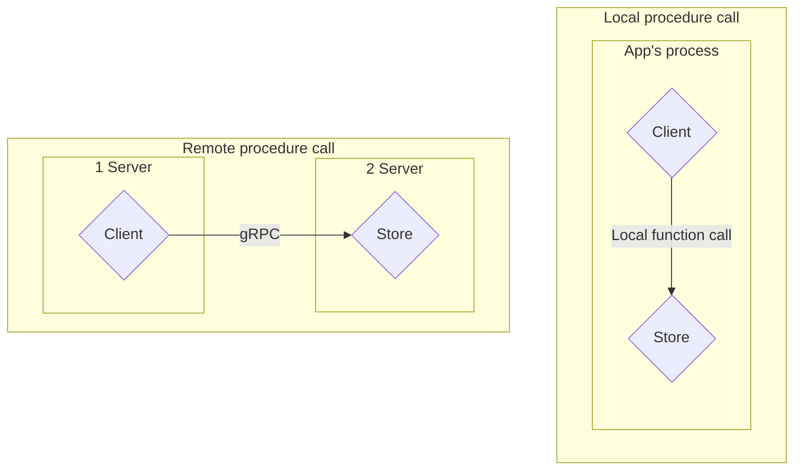

{/*

Source: recreated from the supplied video screenshot <Cite id="coding-gopher-grpc" author="The Coding Gopher" year="n.d." />.

A **local call** runs within the application's process. A **remote call** crosses a process boundary and, in this example, a network connection between two servers. gRPC makes that call look like a method invocation, but serialization, network latency, and connection failures still apply.

## Protocol Buffer

*/}

## Google Remote Procedure Call (gRPC)

### RPC and gRPC timeline

<GrpcTimeline />

## Case studies

{/*

## Service-to-service calls with gRPC

Services call each other to request data or delegate work. **gRPC** uses typed contracts, typically Protocol Buffers and HTTP/2, for efficient communication across languages.

For example, an online shop's **Order service** asks its **Inventory service** if an item is in stock.

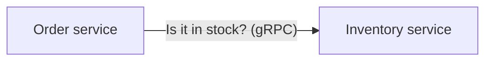

### Order and payment: local call vs. RPC

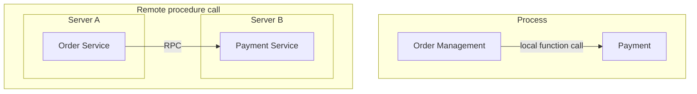

Source: recreated from the supplied video screenshot <Cite id="coding-gopher-grpc" author="The Coding Gopher" year="n.d." />.

The local version calls payment code within the same process. The distributed version separates order and payment into services, with an RPC crossing the boundary.

### Client and server stubs

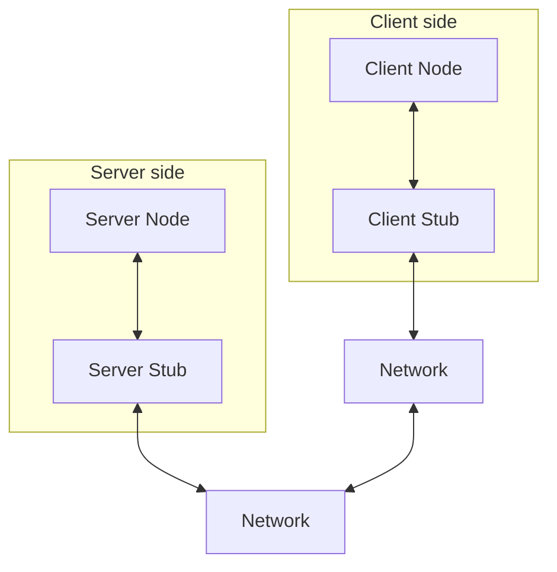

Source: recreated from the supplied video screenshot <Cite id="coding-gopher-grpc" author="The Coding Gopher" year="n.d." />.

The **Client Node** is your calling application; the **Server Node** is the service implementation. The client stub and gRPC runtime send the request across the network. The **Server Stub** represents the server-side bindings that route it to your handler. The reply travels back along the same path. The two Network boxes represent each side's network connection, not two extra services.

### RPC call: serialization and transport

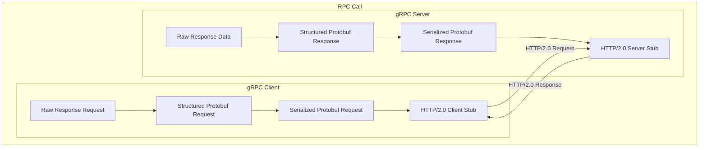

Source: recreated from the supplied video screenshot <Cite id="coding-gopher-grpc" author="The Coding Gopher" year="n.d." />.

The screenshot's **Raw Response Request** label refers to the client's raw request data. Each side converts its outgoing message into Protobuf bytes; the gRPC runtime transports those bytes over HTTP/2. The receiving side deserializes them before invoking the server handler or returning the reply to the client. The diagram focuses on outgoing serialization, so it omits those receiving steps.

### About gRPC

It's basically an alternative to REST or GraphQL.

Begs the questionwhen to use it. It's typicallyt used as a servioce to service commmiunication, you are unlikely to use gRPC to talk to your front-end. it's very efficient for back-end services talking to each other.

### From .proto to application code

**PB** means **Protocol Buffers**. The diagram shows how a `.proto` definition becomes code your application can use to encode and decode messages.

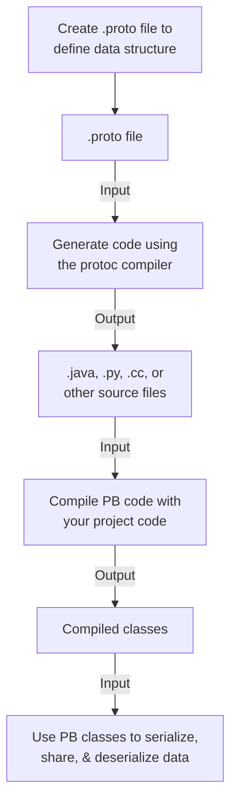

Source: recreated from the supplied video screenshot <Cite id="coding-gopher-grpc" author="The Coding Gopher" year="n.d." />.

For gRPC, compiler plugins also generate client stubs and server interfaces. The compilation step depends on the language: Go and Java compile the generated code with the application; Python imports the generated `.py` modules without a separate manual compilation step.

### Code generation, serialization, and deserialization

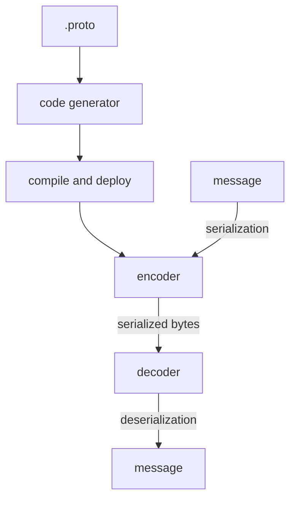

Source: recreated from the supplied video screenshot <Cite id="coding-gopher-grpc" author="The Coding Gopher" year="n.d." />.

Code generation happens before the application runs. At runtime, the encoder converts a message into bytes, and the decoder reconstructs a message from those bytes. Both communicating applications need the appropriate generated code and runtime support.

### Define, compile, generate, implement

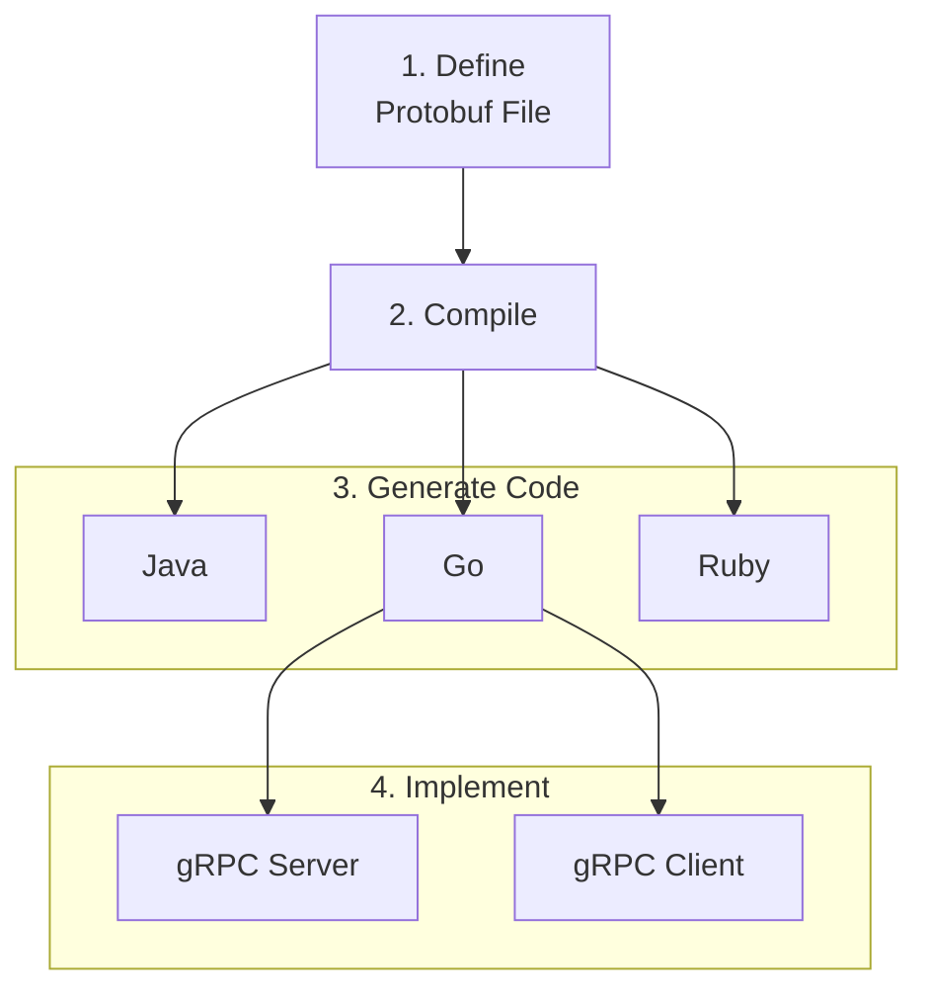

Source: recreated from the supplied video screenshot <Cite id="coding-gopher-grpc" author="The Coding Gopher" year="n.d." />.

Here, **Compile** means running `protoc` with the appropriate language plugins to generate source code, not building the final application. Go is the example connected to the client and server; the same workflow applies to Java, Ruby, and other supported languages.

### Language and platform-neutral

```proto
syntax = "proto3";

message Person {
  string first_name = 1;
  string last_name = 2;
  int32 age = 3;
  float weight = 4;
  repeated string addresses = 5;

  enum Gender {
    Unknown = 0;
    FeMale = 1;
    Male = 2;
  }

  Gender gender = 6;
}
```

Source: transcribed from the supplied video screenshot <Cite id="coding-gopher-grpc" author="The Coding Gopher" year="n.d." />.

The screenshot labels the parts of `string first_name = 1;` as **field type** (`string`), **field name** (`first_name`), and **field tag** (`1`). The tag identifies the field in the binary encoding; it is not the field's default value. `syntax = "proto3";` selects the Protobuf syntax version, `message Person` defines a message type, and `repeated` allows multiple values.

### A calculator contract

`add_service.proto`:

```proto
syntax = "proto3";

package calculator;

// The request message containing the two integers.
message AddRequest {
  int32 a = 1;
  int32 b = 2;
}

// The response message containing the result.
message AddResponse {
  int32 result = 1;
}

// The calculator service definition.
service AddService {
  rpc Add(AddRequest) returns (AddResponse);
}
```

Source: transcribed from the supplied video screenshot <Cite id="coding-gopher-grpc" author="The Coding Gopher" year="n.d." />.

### The pattern

```text
define service contract: RPC(request) -> response
generate message types, client stub, and server interface

server implements RPC(request):
  validate request
  return response

client startup:
  open secure channel
  create stub using channel

handle each request:
  call stub.RPC(request, deadline)
  handle RPC errors separately from a normal response
  use response

shutdown: close channel
```

## Connecting gRPC to other applications

### REST clients through a reverse proxy

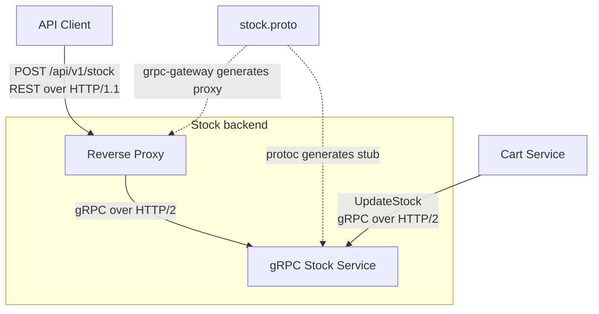

The REST request shown in the screenshot:

```http
POST /api/v1/stock HTTP/1.1
Content-Type: application/json

{"itemNumber": "item4", "quantity": 50}
```

The Cart Service calls the same backend directly through gRPC:

```text
UpdateStock
  itemNumber: "item4"
  quantity: 50
```

Source: recreated and transcribed from the supplied video screenshot <Cite id="coding-gopher-grpc" author="The Coding Gopher" year="n.d." />.

The proxy translates between REST/JSON and gRPC. `grpc-gateway` generates proxy code from an appropriately configured service definition; it does not turn every `.proto` file into a REST API automatically.

### Browser access with gRPC-Web

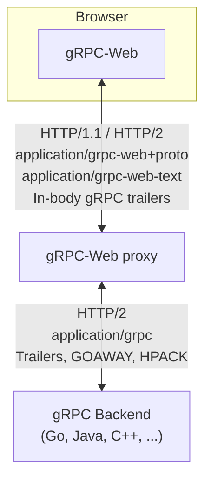

Source: recreated from the supplied video screenshot <Cite id="coding-gopher-grpc" author="The Coding Gopher" year="n.d." />.

The browser uses gRPC-Web rather than native gRPC. The proxy adapts between the browser-facing protocol and the backend's HTTP/2 gRPC connection.

### A polyglot microservices architecture

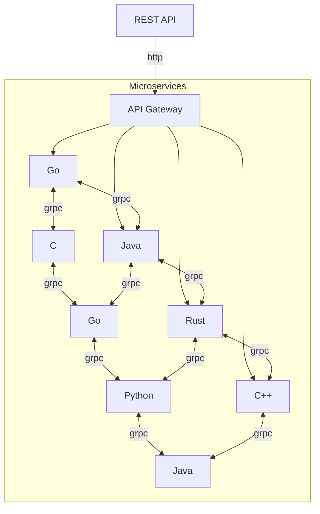

Source: recreated from the supplied video screenshot <Cite id="coding-gopher-grpc" author="The Coding Gopher" year="n.d." />.

An API gateway provides the external HTTP entry point, while internal services communicate through gRPC across language boundaries. The connections illustrate one possible architecture, not a requirement that every service call every other service.

*/}

## Code snippets: Hello World

The classic gRPC Hello World is a **Greeter** service: a client sends a name to `SayHello`, and the server replies with a greeting. These examples share one contract, so a client in any of the three languages can call a server in another.

Each example runs independently on `localhost:50051`. Start one server, then run a client in another terminal. Connections are unencrypted for this local demo only; use TLS outside local development.

### How the code fits together

Read this diagram from top to bottom. You write the client call and the server's greeting logic; gRPC handles sending and receiving the messages.

A **stub** is a local representative of the remote service, generated from your `.proto` file. Calling its `SayHello` method looks like calling an ordinary function, but the stub works with the gRPC runtime to encode your request, send it to the server, and decode the reply. You use the returned message without writing the networking code yourself. Unlike a local function call, it can fail because the server is unreachable or the deadline expires.

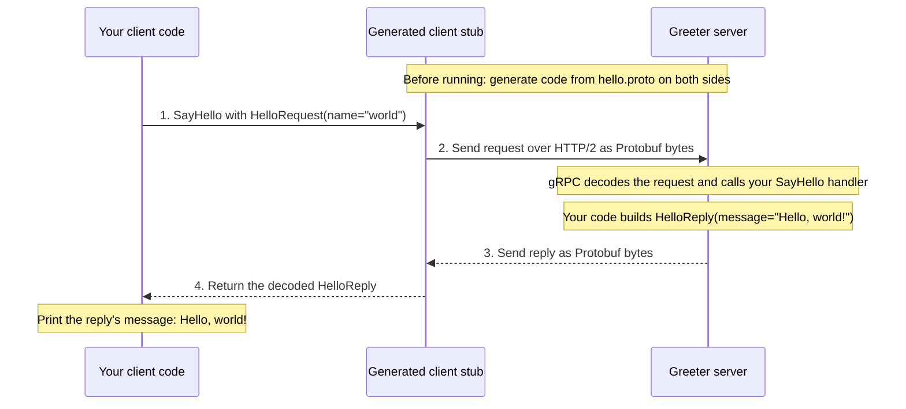

In the snippets, the stub is `NewGreeterClient` in **Go**, `GreeterStub` in **Python**, or `newBlockingStub` in **Java**. The server handler is `SayHello` in Go/Python and `sayHello` in Java. The `.proto` file is the shared agreement, not a separate service running between them.

<CodeWorkspace id="hello-code" label="Hello World example">

<div data-code-file="contract" data-code-label="hello.proto">

### Shared contract

Save as `hello.proto`:

```proto
syntax = "proto3";

package hello;
option go_package = "example.com/hello/hellopb";
option java_package = "hello";
option java_multiple_files = true;

service Greeter {
  rpc SayHello(HelloRequest) returns (HelloReply);
}

message HelloRequest {
  string name = 1;
}

message HelloReply {
  string message = 1;
}
```

</div>

<div data-code-examples>

<div
  data-code-switcher
  role="group"
  aria-label="Hello World example language"
  hidden
>
  <button type="button" value="go" aria-controls="hello-go" aria-pressed="true">
    Go
  </button>
  <button
    type="button"
    value="python"
    aria-controls="hello-python"
    aria-pressed="false"
  >
    Python
  </button>
  <button
    type="button"
    value="java"
    aria-controls="hello-java"
    aria-pressed="false"
  >
    Java
  </button>
</div>

<div id="hello-go" data-code-example="go">

### Go

<div data-code-file="setup" data-code-label="Setup">

With Go and `protoc` installed, generate the code from `hello.proto`:

```sh
go mod init example.com/hello
go get google.golang.org/grpc google.golang.org/protobuf
go install google.golang.org/protobuf/cmd/protoc-gen-go@latest
go install google.golang.org/grpc/cmd/protoc-gen-go-grpc@latest
export PATH="$(go env GOPATH)/bin:$PATH"
protoc --go_out=. --go_opt=module=example.com/hello \
  --go-grpc_out=. --go-grpc_opt=module=example.com/hello hello.proto
```

</div>

<div data-code-file="server" data-code-label="cmd/server/main.go">

**Server** (`cmd/server/main.go`):

```go
package main

import (
    "context"
    "log"
    "net"

    pb "example.com/hello/hellopb"
    "google.golang.org/grpc"
)

type greeter struct {
    pb.UnimplementedGreeterServer
}

func (greeter) SayHello(_ context.Context, req *pb.HelloRequest) (*pb.HelloReply, error) {
    return &pb.HelloReply{Message: "Hello, " + req.GetName() + "!"}, nil
}

func main() {
    listener, err := net.Listen("tcp", "127.0.0.1:50051")
    if err != nil {
        log.Fatal(err)
    }
    server := grpc.NewServer()
    pb.RegisterGreeterServer(server, greeter{})
    log.Fatal(server.Serve(listener))
}
```

</div>

<div data-code-file="client" data-code-label="cmd/client/main.go">

**Client** (`cmd/client/main.go`):

```go
package main

import (
    "context"
    "fmt"
    "log"
    "time"

    pb "example.com/hello/hellopb"
    "google.golang.org/grpc"
    "google.golang.org/grpc/credentials/insecure"
)

func main() {
    conn, err := grpc.NewClient("localhost:50051",
        grpc.WithTransportCredentials(insecure.NewCredentials()))
    if err != nil {
        log.Fatal(err)
    }
    defer conn.Close()

    ctx, cancel := context.WithTimeout(context.Background(), time.Second)
    defer cancel()
    reply, err := pb.NewGreeterClient(conn).SayHello(ctx, &pb.HelloRequest{Name: "world"})
    if err != nil {
        log.Fatal(err)
    }
    fmt.Println(reply.GetMessage())
}
```

</div>

Run `go run ./cmd/server`, then `go run ./cmd/client`.

</div>

<div id="hello-python" data-code-example="python">

### Python

<div data-code-file="setup" data-code-label="Setup">

With Python installed, generate the code beside `hello.proto`:

```sh
python -m venv .venv
```

Activate the environment (`source .venv/bin/activate` on macOS/Linux, `.venv\Scripts\activate` in Windows Command Prompt), then run:

```sh
python -m pip install grpcio grpcio-tools
python -m grpc_tools.protoc -I. --python_out=. --grpc_python_out=. hello.proto
```

</div>

<div data-code-file="server" data-code-label="server.py">

**Server** (`server.py`):

```python
from concurrent import futures

import grpc
import hello_pb2 as pb
import hello_pb2_grpc as rpc


class Greeter(rpc.GreeterServicer):
    def SayHello(self, request, context):
        return pb.HelloReply(message=f"Hello, {request.name}!")


server = grpc.server(futures.ThreadPoolExecutor(max_workers=2))
rpc.add_GreeterServicer_to_server(Greeter(), server)
server.add_insecure_port("127.0.0.1:50051")
server.start()
server.wait_for_termination()
```

</div>

<div data-code-file="client" data-code-label="client.py">

**Client** (`client.py`):

```python
import grpc
import hello_pb2 as pb
import hello_pb2_grpc as rpc

with grpc.insecure_channel("localhost:50051") as channel:
    reply = rpc.GreeterStub(channel).SayHello(
        pb.HelloRequest(name="world"), timeout=1
    )
    print(reply.message)
```

</div>

Run `python server.py`, then `python client.py` with the environment activated in both terminals. RPC errors propagate as exceptions.

</div>

<div id="hello-java" data-code-example="java">

### Java

<div data-code-file="setup" data-code-label="build.gradle">

With JDK 17 and Gradle installed, put `hello.proto` in `src/main/proto/`. Gradle downloads the compiler and generates the Java code.

**Build configuration** (`build.gradle`):

```groovy
plugins {
    id 'application'
    id 'com.google.protobuf' version '0.9.4'
}

repositories {
    mavenCentral()
}

def grpcVersion = '1.68.1'

dependencies {
    implementation "io.grpc:grpc-netty-shaded:$grpcVersion"
    implementation "io.grpc:grpc-protobuf:$grpcVersion"
    implementation "io.grpc:grpc-stub:$grpcVersion"
    compileOnly 'javax.annotation:javax.annotation-api:1.3.2'
}

protobuf {
    protoc { artifact = 'com.google.protobuf:protoc:3.25.5' }
    plugins {
        grpc { artifact = "io.grpc:protoc-gen-grpc-java:$grpcVersion" }
    }
    generateProtoTasks {
        all().each { task -> task.plugins { grpc {} } }
    }
}

application {
    mainClass = project.findProperty('mainClass') ?: 'HelloServer'
}
```

</div>

<div data-code-file="server" data-code-label="src/main/java/HelloServer.java">

**Server** (`src/main/java/HelloServer.java`):

```java
import hello.GreeterGrpc;
import hello.HelloReply;
import hello.HelloRequest;
import io.grpc.netty.shaded.io.grpc.netty.NettyServerBuilder;
import io.grpc.stub.StreamObserver;
import java.net.InetSocketAddress;

public class HelloServer {
    public static void main(String[] args) throws Exception {
        var server = NettyServerBuilder
            .forAddress(new InetSocketAddress("127.0.0.1", 50051))
            .addService(new GreeterGrpc.GreeterImplBase() {
                @Override
                public void sayHello(HelloRequest request,
                        StreamObserver<HelloReply> response) {
                    response.onNext(HelloReply.newBuilder()
                        .setMessage("Hello, " + request.getName() + "!")
                        .build());
                    response.onCompleted();
                }
            })
            .build()
            .start();
        server.awaitTermination();
    }
}
```

</div>

<div data-code-file="client" data-code-label="src/main/java/HelloClient.java">

**Client** (`src/main/java/HelloClient.java`):

```java
import hello.GreeterGrpc;
import hello.HelloRequest;
import io.grpc.Grpc;
import io.grpc.InsecureChannelCredentials;
import java.util.concurrent.TimeUnit;

public class HelloClient {
    public static void main(String[] args) throws Exception {
        var channel = Grpc.newChannelBuilder("localhost:50051",
            InsecureChannelCredentials.create()).build();
        try {
            var reply = GreeterGrpc.newBlockingStub(channel)
                .withDeadlineAfter(1, TimeUnit.SECONDS)
                .sayHello(HelloRequest.newBuilder().setName("world").build());
            System.out.println(reply.getMessage());
        } finally {
            channel.shutdownNow().awaitTermination(5, TimeUnit.SECONDS);
        }
    }
}
```

</div>

Run `gradle run`, then `gradle run -PmainClass=HelloClient`.

</div>

</div>

</CodeWorkspace>

Each client prints:

```text
Hello, world!
```

## Implementation

The **Order service** acts as a gRPC client of the **Inventory service**, which implements `CheckStock`. These examples cover Go, Java, JavaScript (Node.js), and Python using the official gRPC libraries. All four use the same contract, TLS, and a one-second RPC deadline, so you can mix client and server languages.

The Order code shows only its outbound call; a real service should also propagate incoming cancellation and deadlines. The stock data is illustrative: production systems should authenticate callers (for example, with mTLS), use a persistent store and reserve stock atomically.

### Order/Inventory imports

These are the gRPC library imports. The complete snippets below also import standard-library helpers and generated bindings where needed.

<CodeWorkspace id="shop-imports-code" label="Order and Inventory imports">

<div data-code-examples="shop-imports" data-code-file="imports" data-code-label="Imports">

<div
  data-code-switcher
  role="group"
  aria-label="Order and Inventory imports language"
  hidden
>
  <button
    type="button"
    value="go"
    aria-controls="shop-imports-go"
    aria-pressed="true"
  >
    Go
  </button>
  <button
    type="button"
    value="java"
    aria-controls="shop-imports-java"
    aria-pressed="false"
  >
    Java
  </button>
  <button
    type="button"
    value="node"
    aria-controls="shop-imports-node"
    aria-pressed="false"
  >
    JavaScript (Node.js)
  </button>
  <button
    type="button"
    value="python"
    aria-controls="shop-imports-python"
    aria-pressed="false"
  >
    Python
  </button>
</div>

<div id="shop-imports-go" data-code-example="go">

```go
import (
    "google.golang.org/grpc"
    "google.golang.org/grpc/codes"
    "google.golang.org/grpc/credentials"
    "google.golang.org/grpc/status"
)
```

</div>

<div id="shop-imports-java" data-code-example="java">

```java
import io.grpc.Grpc;
import io.grpc.ManagedChannel;
import io.grpc.Status;
import io.grpc.TlsChannelCredentials;
import io.grpc.netty.shaded.io.grpc.netty.NettyServerBuilder;
import io.grpc.stub.StreamObserver;
```

</div>

<div id="shop-imports-node" data-code-example="node">

```javascript
import * as grpc from "@grpc/grpc-js";
import * as protoLoader from "@grpc/proto-loader";
```

</div>

<div id="shop-imports-python" data-code-example="python">

```python
import grpc
```

</div>

</div>

</CodeWorkspace>

### Order/Inventory project structure

Generated bindings and installed dependencies are omitted.

<CodeWorkspace id="shop-structure-code" label="Order and Inventory project structure">

<div data-code-examples="shop-structure" data-code-file="structure" data-code-label="Project layout">

<div
  data-code-switcher
  role="group"
  aria-label="Order and Inventory project structure language"
  hidden
>
  <button
    type="button"
    value="go"
    aria-controls="shop-structure-go"
    aria-pressed="true"
  >
    Go
  </button>
  <button
    type="button"
    value="java"
    aria-controls="shop-structure-java"
    aria-pressed="false"
  >
    Java
  </button>
  <button
    type="button"
    value="node"
    aria-controls="shop-structure-node"
    aria-pressed="false"
  >
    JavaScript (Node.js)
  </button>
  <button
    type="button"
    value="python"
    aria-controls="shop-structure-python"
    aria-pressed="false"
  >
    Python
  </button>
</div>

<div id="shop-structure-go" data-code-example="go">

```text
order-inventory-go/
|-- go.mod
|-- inventory.proto
`-- cmd/
    |-- inventory/
    |   `-- main.go
    `-- order/
        `-- main.go
```

The generated Go package goes in `inventorypb`, matching `example.com/shop/inventorypb` in the imports.

</div>

<div id="shop-structure-java" data-code-example="java">

```text
order-inventory-java/
|-- build.gradle
`-- src/
    `-- main/
        |-- proto/
        |   `-- inventory.proto
        `-- java/
            |-- InventoryServer.java
            `-- OrderClient.java
```

</div>

<div id="shop-structure-node" data-code-example="node">

```text
order-inventory-node/
|-- package.json
|-- inventory.proto
|-- inventory.mjs
`-- order.mjs
```

</div>

<div id="shop-structure-python" data-code-example="python">

```text
order-inventory-python/
|-- inventory.proto
|-- inventory.py
`-- order.py
```

</div>

</div>

</CodeWorkspace>

<CodeWorkspace id="shop-files-code" label="Order and Inventory source files">

<div data-code-file="contract" data-code-label="inventory.proto">

### inventory.proto

Use this same contract in all four languages. The Go and Java options only control the generated code's package layout.

```proto
syntax = "proto3";

package shop.inventory.v1;

option go_package = "example.com/shop/inventorypb";
option java_package = "shop.inventory.v1";
option java_multiple_files = true;

service Inventory {
  rpc CheckStock(CheckStockRequest) returns (CheckStockResponse);
}

message CheckStockRequest {
  string sku = 1;
  int32 quantity = 2;
}

message CheckStockResponse {
  bool in_stock = 1;
}
```

</div>

<div data-code-file="server" data-code-label="Inventory server">

### Inventory service (server)

The sample inventory contains ten units of `book`. Unknown SKUs have no stock; an empty SKU or non-positive quantity returns `INVALID_ARGUMENT`. Run only one Inventory server at a time on port `50051`.

<div data-code-examples="shop-inventory">

<div
  data-code-switcher
  role="group"
  aria-label="Inventory server language"
  hidden
>
  <button
    type="button"
    value="go"
    aria-controls="shop-inventory-go"
    aria-pressed="true"
  >
    Go
  </button>
  <button
    type="button"
    value="java"
    aria-controls="shop-inventory-java"
    aria-pressed="false"
  >
    Java
  </button>
  <button
    type="button"
    value="node"
    aria-controls="shop-inventory-node"
    aria-pressed="false"
  >
    JavaScript (Node.js)
  </button>
  <button
    type="button"
    value="python"
    aria-controls="shop-inventory-python"
    aria-pressed="false"
  >
    Python
  </button>
</div>

<div id="shop-inventory-go" data-code-example="go" data-code-filename="cmd/inventory/main.go">

#### Go (`cmd/inventory/main.go`)

```go
package main

import (
    "context"
    "log"
    "net"
    "os"

    pb "example.com/shop/inventorypb"
    "google.golang.org/grpc"
    "google.golang.org/grpc/codes"
    "google.golang.org/grpc/credentials"
    "google.golang.org/grpc/status"
)

type inventoryServer struct {
    pb.UnimplementedInventoryServer
}

func (s *inventoryServer) CheckStock(ctx context.Context, req *pb.CheckStockRequest) (*pb.CheckStockResponse, error) {
    if req.GetSku() == "" || req.GetQuantity() <= 0 {
        return nil, status.Error(codes.InvalidArgument, "SKU and positive quantity required")
    }

    stock := map[string]int32{"book": 10}
    return &pb.CheckStockResponse{InStock: stock[req.GetSku()] >= req.GetQuantity()}, nil
}

func main() {
    creds, err := credentials.NewServerTLSFromFile(os.Getenv("TLS_CERT_FILE"), os.Getenv("TLS_KEY_FILE"))
    if err != nil {
        log.Fatal(err)
    }
    listener, err := net.Listen("tcp", "127.0.0.1:50051")
    if err != nil {
        log.Fatal(err)
    }

    server := grpc.NewServer(grpc.Creds(creds))
    pb.RegisterInventoryServer(server, &inventoryServer{})
    log.Println("Inventory service listening on 127.0.0.1:50051")
    if err := server.Serve(listener); err != nil {
        log.Fatal(err)
    }
}
```

</div>

<div id="shop-inventory-java" data-code-example="java" data-code-filename="src/main/java/InventoryServer.java">

#### Java (`src/main/java/InventoryServer.java`)

```java
import io.grpc.Status;
import io.grpc.netty.shaded.io.grpc.netty.NettyServerBuilder;
import io.grpc.stub.StreamObserver;
import java.io.File;
import java.net.InetSocketAddress;
import shop.inventory.v1.CheckStockRequest;
import shop.inventory.v1.CheckStockResponse;
import shop.inventory.v1.InventoryGrpc;

public class InventoryServer {
    public static void main(String[] args) throws Exception {
        var server = NettyServerBuilder
            .forAddress(new InetSocketAddress("127.0.0.1", 50051))
            .useTransportSecurity(
                new File(System.getenv("TLS_CERT_FILE")),
                new File(System.getenv("TLS_KEY_FILE")))
            .addService(new InventoryGrpc.InventoryImplBase() {
                @Override
                public void checkStock(CheckStockRequest request,
                        StreamObserver<CheckStockResponse> response) {
                    if (request.getSku().isEmpty() || request.getQuantity() <= 0) {
                        response.onError(Status.INVALID_ARGUMENT
                            .withDescription("SKU and positive quantity required")
                            .asRuntimeException());
                        return;
                    }

                    int available = request.getSku().equals("book") ? 10 : 0;
                    response.onNext(CheckStockResponse.newBuilder()
                        .setInStock(available >= request.getQuantity())
                        .build());
                    response.onCompleted();
                }
            })
            .build()
            .start();

        System.out.println("Inventory service listening on 127.0.0.1:50051");
        server.awaitTermination();
    }
}
```

</div>

<div id="shop-inventory-node" data-code-example="node" data-code-filename="inventory.mjs">

#### JavaScript (Node.js) (`inventory.mjs`)

```javascript
import { readFileSync } from "node:fs";
import * as grpc from "@grpc/grpc-js";
import * as protoLoader from "@grpc/proto-loader";

const definition = protoLoader.loadSync("inventory.proto", {
  keepCase: true,
  defaults: true,
});
const { shop } = grpc.loadPackageDefinition(definition);
const inventory = shop.inventory.v1;

const server = new grpc.Server();
server.addService(inventory.Inventory.service, {
  checkStock(call, callback) {
    if (!call.request.sku || call.request.quantity <= 0) {
      callback({
        code: grpc.status.INVALID_ARGUMENT,
        details: "SKU and positive quantity required",
      });
      return;
    }

    const stock = new Map([["book", 10]]);
    const available = stock.get(call.request.sku) ?? 0;
    callback(null, { in_stock: available >= call.request.quantity });
  },
});

const credentials = grpc.ServerCredentials.createSsl(null, [
  {
    private_key: readFileSync(process.env.TLS_KEY_FILE),
    cert_chain: readFileSync(process.env.TLS_CERT_FILE),
  },
]);

server.bindAsync("127.0.0.1:50051", credentials, (error) => {
  if (error) {
    console.error(error);
    process.exitCode = 1;
    return;
  }

  console.log("Inventory service listening on 127.0.0.1:50051");
});
```

</div>

<div id="shop-inventory-python" data-code-example="python" data-code-filename="inventory.py">

#### Python (`inventory.py`)

```python
from concurrent import futures
import os
from pathlib import Path

import grpc
import inventory_pb2
import inventory_pb2_grpc


class Inventory(inventory_pb2_grpc.InventoryServicer):
    def CheckStock(self, request, context):
        if not request.sku or request.quantity <= 0:
            context.abort(grpc.StatusCode.INVALID_ARGUMENT, "SKU and positive quantity required")

        available = {"book": 10}.get(request.sku, 0)
        return inventory_pb2.CheckStockResponse(in_stock=available >= request.quantity)


server = grpc.server(futures.ThreadPoolExecutor(max_workers=10))
inventory_pb2_grpc.add_InventoryServicer_to_server(Inventory(), server)
key = Path(os.environ["TLS_KEY_FILE"]).read_bytes()
cert = Path(os.environ["TLS_CERT_FILE"]).read_bytes()
server.add_secure_port("127.0.0.1:50051", grpc.ssl_server_credentials(((key, cert),)))
server.start()
print("Inventory service listening on 127.0.0.1:50051", flush=True)
server.wait_for_termination()
```

</div>

</div>

</div>

<div data-code-file="client" data-code-label="Order client">

### Order service (client)

The Order service asks whether one `book` is available. The channel and client stub should be created once and reused for subsequent requests.

<div data-code-examples="shop-order">

<div data-code-switcher role="group" aria-label="Order client language" hidden>
  <button
    type="button"
    value="go"
    aria-controls="shop-order-go"
    aria-pressed="true"
  >
    Go
  </button>
  <button
    type="button"
    value="java"
    aria-controls="shop-order-java"
    aria-pressed="false"
  >
    Java
  </button>
  <button
    type="button"
    value="node"
    aria-controls="shop-order-node"
    aria-pressed="false"
  >
    JavaScript (Node.js)
  </button>
  <button
    type="button"
    value="python"
    aria-controls="shop-order-python"
    aria-pressed="false"
  >
    Python
  </button>
</div>

<div id="shop-order-go" data-code-example="go" data-code-filename="cmd/order/main.go">

#### Go (`cmd/order/main.go`)

```go
package main

import (
    "context"
    "log"
    "os"
    "time"

    pb "example.com/shop/inventorypb"
    "google.golang.org/grpc"
    "google.golang.org/grpc/credentials"
)

func main() {
    creds, err := credentials.NewClientTLSFromFile(os.Getenv("CA_CERT_FILE"), "")
    if err != nil {
        log.Fatal(err)
    }
    conn, err := grpc.NewClient(os.Getenv("INVENTORY_ADDRESS"), grpc.WithTransportCredentials(creds))
    if err != nil {
        log.Fatal(err)
    }
    defer conn.Close()

    client := pb.NewInventoryClient(conn)
    ctx, cancel := context.WithTimeout(context.Background(), time.Second)
    defer cancel()
    result, err := client.CheckStock(ctx, &pb.CheckStockRequest{Sku: "book", Quantity: 1})
    if err != nil {
        log.Fatalf("Inventory RPC failed: %v", err)
    }
    log.Printf("In stock: %t", result.GetInStock())
}
```

</div>

<div id="shop-order-java" data-code-example="java" data-code-filename="src/main/java/OrderClient.java">

#### Java (`src/main/java/OrderClient.java`)

```java
import io.grpc.Grpc;
import io.grpc.ManagedChannel;
import io.grpc.TlsChannelCredentials;
import java.io.File;
import java.util.concurrent.TimeUnit;
import shop.inventory.v1.CheckStockRequest;
import shop.inventory.v1.InventoryGrpc;

public class OrderClient {
    public static void main(String[] args) throws Exception {
        var credentials = TlsChannelCredentials.newBuilder()
            .trustManager(new File(System.getenv("CA_CERT_FILE")))
            .build();
        ManagedChannel channel = Grpc.newChannelBuilder(
            System.getenv("INVENTORY_ADDRESS"), credentials
        ).build();

        try {
            var client = InventoryGrpc.newBlockingStub(channel);
            var result = client.withDeadlineAfter(1, TimeUnit.SECONDS)
                .checkStock(CheckStockRequest.newBuilder()
                    .setSku("book")
                    .setQuantity(1)
                    .build());
            System.out.println("In stock: " + result.getInStock());
        } finally {
            channel.shutdownNow();
        }
    }
}
```

</div>

<div id="shop-order-node" data-code-example="node" data-code-filename="order.mjs">

#### JavaScript (Node.js) (`order.mjs`)

```javascript
import { readFileSync } from "node:fs";
import * as grpc from "@grpc/grpc-js";
import * as protoLoader from "@grpc/proto-loader";

const definition = protoLoader.loadSync("inventory.proto", {
  keepCase: true,
  defaults: true,
});
const { shop } = grpc.loadPackageDefinition(definition);
const credentials = grpc.credentials.createSsl(
  readFileSync(process.env.CA_CERT_FILE),
);
const client = new shop.inventory.v1.Inventory(
  process.env.INVENTORY_ADDRESS,
  credentials,
);

client.checkStock(
  { sku: "book", quantity: 1 },
  { deadline: new Date(Date.now() + 1000) },
  (error, result) => {
    client.close();

    if (error) {
      console.error(error);
      process.exitCode = 1;
      return;
    }

    console.log("In stock:", result.in_stock);
  },
);
```

</div>

<div id="shop-order-python" data-code-example="python" data-code-filename="order.py">

#### Python (`order.py`)

```python
import os
from pathlib import Path

import grpc
import inventory_pb2
import inventory_pb2_grpc


class OrderService:
    def __init__(self):
        ca = Path(os.environ["CA_CERT_FILE"]).read_bytes()
        credentials = grpc.ssl_channel_credentials(root_certificates=ca)
        self.channel = grpc.secure_channel(os.environ["INVENTORY_ADDRESS"], credentials)
        self.inventory = inventory_pb2_grpc.InventoryStub(self.channel)

    def check_stock(self, sku, quantity):
        try:
            response = self.inventory.CheckStock(
                inventory_pb2.CheckStockRequest(sku=sku, quantity=quantity),
                timeout=1.0,
            )
        except grpc.RpcError as error:
            raise RuntimeError(f"Inventory RPC failed: {error.code().name}") from error
        return response.in_stock

    def close(self):
        self.channel.close()


if __name__ == "__main__":
    service = OrderService()
    try:
        print("In stock:", service.check_stock("book", 1))
    finally:
        service.close()
```

</div>

</div>

</div>

</CodeWorkspace>

### Generate and run the Order/Inventory example

Provide a TLS certificate and private key for the Inventory service. The Order service's CA file must trust that certificate, and the address hostname must match its subject alternative name. Set these environment variables in **both terminals**, using absolute file paths:

```sh
export TLS_CERT_FILE="/absolute/path/inventory.crt"
export TLS_KEY_FILE="/absolute/path/inventory.key"
export CA_CERT_FILE="/absolute/path/ca.crt"
export INVENTORY_ADDRESS="localhost:50051"
```

For a local self-signed certificate, `CA_CERT_FILE` can point to the server's certificate. Do not commit private keys. The examples below assume the server certificate covers `localhost`.

<CodeWorkspace id="shop-run-code" label="Order and Inventory setup and run commands">

<div data-code-examples="shop-run">

<div
  data-code-switcher
  role="group"
  aria-label="Order and Inventory run instructions language"
  hidden
>
  <button
    type="button"
    value="go"
    aria-controls="shop-run-go"
    aria-pressed="true"
  >
    Go
  </button>
  <button
    type="button"
    value="java"
    aria-controls="shop-run-java"
    aria-pressed="false"
  >
    Java
  </button>
  <button
    type="button"
    value="node"
    aria-controls="shop-run-node"
    aria-pressed="false"
  >
    JavaScript (Node.js)
  </button>
  <button
    type="button"
    value="python"
    aria-controls="shop-run-python"
    aria-pressed="false"
  >
    Python
  </button>
</div>

<div id="shop-run-go" data-code-example="go">

<div data-code-file="server-run" data-code-label="Start Inventory">

With Go and `protoc` installed, run from `order-inventory-go`:

```sh
go mod init example.com/shop
go get google.golang.org/grpc google.golang.org/protobuf
go install google.golang.org/protobuf/cmd/protoc-gen-go@latest
go install google.golang.org/grpc/cmd/protoc-gen-go-grpc@latest
export PATH="$PATH:$(go env GOPATH)/bin"
protoc -I . --go_out=. --go_opt=module=example.com/shop --go-grpc_out=. --go-grpc_opt=module=example.com/shop inventory.proto
go run ./cmd/inventory
```

</div>

<div data-code-file="client-run" data-code-label="Call Inventory">

In another terminal, enter the same folder and run:

```sh
go run ./cmd/order
```

</div>

</div>

<div id="shop-run-java" data-code-example="java">

<div data-code-file="build" data-code-label="build.gradle">

With JDK 17 and Gradle installed, save this as `build.gradle` in `order-inventory-java`. It uses the same build setup as the Java Hello World example above.

```groovy
plugins {
    id 'application'
    id 'com.google.protobuf' version '0.9.4'
}

repositories {
    mavenCentral()
}

def grpcVersion = '1.68.1'

dependencies {
    implementation "io.grpc:grpc-netty-shaded:$grpcVersion"
    implementation "io.grpc:grpc-protobuf:$grpcVersion"
    implementation "io.grpc:grpc-stub:$grpcVersion"
    compileOnly 'javax.annotation:javax.annotation-api:1.3.2'
}

protobuf {
    protoc { artifact = 'com.google.protobuf:protoc:3.25.5' }
    plugins {
        grpc { artifact = "io.grpc:protoc-gen-grpc-java:$grpcVersion" }
    }
    generateProtoTasks {
        all().each { task -> task.plugins { grpc {} } }
    }
}

application {
    mainClass = project.findProperty('mainClass') ?: 'InventoryServer'
}
```

</div>

<div data-code-file="server-run" data-code-label="Start Inventory">

Gradle generates the Java bindings automatically. Start the server:

```sh
gradle run
```

</div>

<div data-code-file="client-run" data-code-label="Call Inventory">

In another terminal, enter the same folder and run:

```sh
gradle run -PmainClass=OrderClient
```

</div>

</div>

<div id="shop-run-node" data-code-example="node">

<div data-code-file="server-run" data-code-label="Start Inventory">

From `order-inventory-node`, install the official libraries and start the server:

```sh
npm init -y
npm install @grpc/grpc-js @grpc/proto-loader
node inventory.mjs
```

</div>

<div data-code-file="client-run" data-code-label="Call Inventory">

Node.js loads `inventory.proto` at runtime, so no separate code-generation step is needed. In another terminal, enter the same folder and run:

```sh
node order.mjs
```

</div>

</div>

<div id="shop-run-python" data-code-example="python">

<div data-code-file="server-run" data-code-label="Start Inventory">

From `order-inventory-python`, create an environment, install the tools, generate the bindings, and start the server:

```sh
python3 -m venv .venv
source .venv/bin/activate
python -m pip install grpcio grpcio-tools
python -m grpc_tools.protoc -I. --python_out=. --grpc_python_out=. inventory.proto
python inventory.py
```

</div>

<div data-code-file="client-run" data-code-label="Call Inventory">

In another terminal, enter the same folder, activate the environment, and run:

```sh
source .venv/bin/activate
python order.py
```

</div>

</div>

</div>

</CodeWorkspace>

The Order client prints `In stock: true` (`True` in Python). Requesting more than ten books or an unknown SKU returns `false`; invalid requests produce a gRPC error instead.

## Health checks for a gRPC server

```mermaid
flowchart TD
    subgraph HTTP["1. httpGet probe"]
        KubeletHTTP["kubelet"]
        subgraph ContainerHTTP["Container"]
            AppHTTP["gRPC server app"]
        end
        KubeletHTTP -->|"httpGet probe"| AppHTTP
    end

    subgraph TCP["2. tcpSocket probe"]
        KubeletTCP["kubelet"]
        subgraph ContainerTCP["Container"]
            AppTCP["gRPC server app"]
        end
        KubeletTCP -->|"tcpSocket probe"| AppTCP
    end

    subgraph Exec["3. exec probe"]
        KubeletExec["kubelet"]
        subgraph ContainerExec["Container"]
            TestClient["gRPC test client"]
            AppExec["gRPC server app"]
            TestClient -->|"custom grpc call"| AppExec
        end
        KubeletExec -->|"exec probe"| TestClient
    end
```

Source: recreated from the supplied video screenshot <Cite id="coding-gopher-grpc" author="The Coding Gopher" year="n.d." />.

These are the three approaches shown in the screenshot, not an exhaustive list. Kubernetes also supports native gRPC probes when the application implements the standard gRPC Health Checking Protocol <Cite id="kubernetes-probes" author="Kubernetes" year="n.d." />.

btw gRPC stands for Google RPC (Remote Procedure Call). RPC is a classic that's existed for years (think about your distributedf system class)

This one is just a different take on it: others exist like webRPC

## gRPC library imports

<CodeWorkspace id="library-imports-code" label="gRPC library imports">

<div data-code-examples="library-imports" data-code-file="imports" data-code-label="Imports">

<div data-code-switcher role="group" aria-label="gRPC library language" hidden>
  <button
    type="button"
    value="go"
    aria-controls="imports-go"
    aria-pressed="true"
  >
    Go
  </button>
  <button
    type="button"
    value="java"
    aria-controls="imports-java"
    aria-pressed="false"
  >
    Java
  </button>
  <button
    type="button"
    value="python"
    aria-controls="imports-python"
    aria-pressed="false"
  >
    Python
  </button>
  <button
    type="button"
    value="node"
    aria-controls="imports-node"
    aria-pressed="false"
  >
    JavaScript (Node.js)
  </button>
</div>

<div id="imports-go" data-code-example="go">

```go
import "google.golang.org/grpc"
```

</div>

<div id="imports-java" data-code-example="java">

```java
import io.grpc.ManagedChannelBuilder;
import io.grpc.ServerBuilder;
import io.grpc.stub.StreamObserver;
```

</div>

<div id="imports-python" data-code-example="python">

```python
import grpc
```

</div>

<div id="imports-node" data-code-example="node">

```javascript
import * as grpc from "@grpc/grpc-js";
import * as protoLoader from "@grpc/proto-loader";
```

</div>

</div>

</CodeWorkspace>

## Project structure

Each project has a server, a client, and the same `user.proto` contract. Generated bindings and installed dependencies are omitted from these source layouts.

<CodeWorkspace id="user-structure-code" label="User service project structure">

<div data-code-examples="project-structure" data-code-file="structure" data-code-label="Project layout">

<div
  data-code-switcher
  role="group"
  aria-label="Project structure language"
  hidden
>
  <button
    type="button"
    value="go"
    aria-controls="structure-go"
    aria-pressed="true"
  >
    Go
  </button>
  <button
    type="button"
    value="java"
    aria-controls="structure-java"
    aria-pressed="false"
  >
    Java
  </button>
  <button
    type="button"
    value="node"
    aria-controls="structure-node"
    aria-pressed="false"
  >
    JavaScript (Node.js)
  </button>
  <button
    type="button"
    value="python"
    aria-controls="structure-python"
    aria-pressed="false"
  >
    Python
  </button>
</div>

<div id="structure-go" data-code-example="go">

```text
grpc-go/
|-- go.mod
|-- user.proto
`-- cmd/
    |-- server/
    |   `-- main.go
    `-- client/
        `-- main.go
```

Save the Go server and client snippets in their respective `main.go` files. The generated `pb` package belongs in `gen/users`.

</div>

<div id="structure-java" data-code-example="java">

```text
grpc-java/
|-- build.gradle
`-- src/
    `-- main/
        |-- proto/
        |   `-- user.proto
        `-- java/
            |-- Server.java
            `-- Client.java
```

</div>

<div id="structure-node" data-code-example="node">

```text
grpc-node/
|-- package.json
|-- server.mjs
|-- client.mjs
`-- user.proto
```

</div>

<div id="structure-python" data-code-example="python">

```text
grpc-python/
|-- server.py
|-- client.py
`-- user.proto
```

</div>

</div>

</CodeWorkspace>

<CodeWorkspace id="user-files-code" label="User service source files">

<div data-code-file="contract" data-code-label="user.proto">

### user.proto

The client sends a user ID, and the server returns the matching user.

```proto
syntax = "proto3";

package users;

service UserService {
  rpc GetUser (GetUserRequest) returns (User);
}

message GetUserRequest {
  int32 id = 1;
}

message User {
  int32 id = 1;
  string name = 2;
  string email = 3;
}
```

</div>

<div data-code-file="server" data-code-label="User server">

### Server

Each server implements the same `UserService.GetUser` contract and returns user `1`. Unknown IDs return `NOT_FOUND`. Run only one server at a time on `127.0.0.1:50051`; clients can call it regardless of the server's language.

<div data-code-examples="user-servers">

<div
  data-code-switcher
  role="group"
  aria-label="User service server language"
  hidden
>
  <button
    type="button"
    value="go"
    aria-controls="user-server-go"
    aria-pressed="true"
  >
    Go
  </button>
  <button
    type="button"
    value="java"
    aria-controls="user-server-java"
    aria-pressed="false"
  >
    Java
  </button>
  <button
    type="button"
    value="node"
    aria-controls="user-server-node"
    aria-pressed="false"
  >
    JavaScript (Node.js)
  </button>
  <button
    type="button"
    value="python"
    aria-controls="user-server-python"
    aria-pressed="false"
  >
    Python
  </button>
</div>

<div id="user-server-go" data-code-example="go" data-code-filename="cmd/server/main.go">

#### Go (`server.go`)

Generate the Go bindings first. Replace the `pb` import path with your generated package's location.

```go
package main

import (
    "context"
    "log"
    "net"

    pb "example.com/grpc-demo/gen/users"
    "google.golang.org/grpc"
    "google.golang.org/grpc/codes"
    "google.golang.org/grpc/status"
)

type userService struct {
    pb.UnimplementedUserServiceServer
}

func (s *userService) GetUser(ctx context.Context, request *pb.GetUserRequest) (*pb.User, error) {
    if request.GetId() != 1 {
        return nil, status.Error(codes.NotFound, "User not found")
    }

    return &pb.User{
        Id:    1,
        Name:  "Ada Lovelace",
        Email: "ada@example.com",
    }, nil
}

func main() {
    listener, err := net.Listen("tcp", "127.0.0.1:50051")
    if err != nil {
        log.Fatal(err)
    }

    server := grpc.NewServer()
    pb.RegisterUserServiceServer(server, &userService{})
    log.Println("User service listening on 127.0.0.1:50051")
    if err := server.Serve(listener); err != nil {
        log.Fatal(err)
    }
}
```

</div>

<div id="user-server-java" data-code-example="java" data-code-filename="src/main/java/Server.java">

#### Java (`Server.java`)

Generate the Java bindings first. This example uses the `grpc-netty-shaded` transport to bind specifically to localhost.

```java
import io.grpc.Status;
import io.grpc.netty.shaded.io.grpc.netty.NettyServerBuilder;
import io.grpc.stub.StreamObserver;
import java.net.InetSocketAddress;
import users.UserOuterClass.GetUserRequest;
import users.UserOuterClass.User;
import users.UserServiceGrpc;

public class Server {
    public static void main(String[] args) throws Exception {
        var server = NettyServerBuilder
            .forAddress(new InetSocketAddress("127.0.0.1", 50051))
            .addService(new UserServiceGrpc.UserServiceImplBase() {
                @Override
                public void getUser(GetUserRequest request,
                        StreamObserver<User> response) {
                    if (request.getId() != 1) {
                        response.onError(Status.NOT_FOUND
                            .withDescription("User not found")
                            .asRuntimeException());
                        return;
                    }

                    response.onNext(User.newBuilder()
                        .setId(1)
                        .setName("Ada Lovelace")
                        .setEmail("ada@example.com")
                        .build());
                    response.onCompleted();
                }
            })
            .build()
            .start();

        System.out.println("User service listening on 127.0.0.1:50051");
        server.awaitTermination();
    }
}
```

</div>

<div id="user-server-node" data-code-example="node" data-code-filename="server.mjs">

#### JavaScript (Node.js) (`server.mjs`)

This server loads `user.proto` at runtime. Run it from the folder containing that file.

```javascript
import * as grpc from "@grpc/grpc-js";
import * as protoLoader from "@grpc/proto-loader";

const definition = protoLoader.loadSync("user.proto");
const { users } = grpc.loadPackageDefinition(definition);

const server = new grpc.Server();
server.addService(users.UserService.service, {
  getUser(call, callback) {
    if (call.request.id !== 1) {
      callback({
        code: grpc.status.NOT_FOUND,
        details: "User not found",
      });
      return;
    }

    callback(null, {
      id: 1,
      name: "Ada Lovelace",
      email: "ada@example.com",
    });
  },
});

server.bindAsync(
  "127.0.0.1:50051",
  grpc.ServerCredentials.createInsecure(),
  (error) => {
    if (error) {
      console.error(error);
      process.exitCode = 1;
      return;
    }

    console.log("User service listening on 127.0.0.1:50051");
  },
);
```

</div>

<div id="user-server-python" data-code-example="python" data-code-filename="server.py">

#### Python (`server.py`)

Generate `user_pb2.py` and `user_pb2_grpc.py` first.

```python
from concurrent import futures

import grpc
import user_pb2 as pb
import user_pb2_grpc as rpc


class UserService(rpc.UserServiceServicer):
    def GetUser(self, request, context):
        users = {
            1: pb.User(
                id=1,
                name="Ada Lovelace",
                email="ada@example.com",
            ),
        }
        user = users.get(request.id)
        if user is None:
            context.abort(grpc.StatusCode.NOT_FOUND, "User not found")
        return user


server = grpc.server(futures.ThreadPoolExecutor(max_workers=2))
rpc.add_UserServiceServicer_to_server(UserService(), server)
server.add_insecure_port("127.0.0.1:50051")
server.start()
print("User service listening on 127.0.0.1:50051", flush=True)
server.wait_for_termination()
```

</div>

</div>

</div>

<div data-code-file="client" data-code-label="User client">

### Client

Each client calls `UserService.GetUser` from the same `user.proto`, requesting user `1` from `127.0.0.1:50051`.

<div data-code-examples="user-clients">

<div
  data-code-switcher
  role="group"
  aria-label="User service client language"
  hidden
>
  <button
    type="button"
    value="go"
    aria-controls="user-client-go"
    aria-pressed="true"
  >
    Go
  </button>
  <button
    type="button"
    value="java"
    aria-controls="user-client-java"
    aria-pressed="false"
  >
    Java
  </button>
  <button
    type="button"
    value="node"
    aria-controls="user-client-node"
    aria-pressed="false"
  >
    JavaScript (Node.js)
  </button>
  <button
    type="button"
    value="python"
    aria-controls="user-client-python"
    aria-pressed="false"
  >
    Python
  </button>
</div>

<div id="user-client-go" data-code-example="go" data-code-filename="cmd/client/main.go">

#### Go (`client.go`)

Generate the Go bindings first. Replace the `pb` import path with your generated package's location.

```go
package main

import (
    "context"
    "fmt"
    "log"
    "time"

    pb "example.com/grpc-demo/gen/users"
    "google.golang.org/grpc"
    "google.golang.org/grpc/credentials/insecure"
)

func main() {
    conn, err := grpc.NewClient(
        "127.0.0.1:50051",
        grpc.WithTransportCredentials(insecure.NewCredentials()),
    )
    if err != nil {
        log.Fatal(err)
    }
    defer conn.Close()

    client := pb.NewUserServiceClient(conn)
    ctx, cancel := context.WithTimeout(context.Background(), 5*time.Second)
    defer cancel()

    user, err := client.GetUser(ctx, &pb.GetUserRequest{Id: 1})
    if err != nil {
        log.Fatal(err)
    }

    fmt.Printf("%d: %s (%s)\n", user.GetId(), user.GetName(), user.GetEmail())
}
```

</div>

<div id="user-client-java" data-code-example="java" data-code-filename="src/main/java/Client.java">

#### Java (`Client.java`)

Generate the Java bindings first. With the `user.proto` above, default Java generation places messages inside `users.UserOuterClass`.

```java
import io.grpc.ManagedChannel;
import io.grpc.ManagedChannelBuilder;
import java.util.concurrent.TimeUnit;
import users.UserOuterClass.GetUserRequest;
import users.UserOuterClass.User;
import users.UserServiceGrpc;

public class Client {
    public static void main(String[] args) {
        ManagedChannel channel = ManagedChannelBuilder
            .forAddress("127.0.0.1", 50051)
            .usePlaintext()
            .build();

        try {
            UserServiceGrpc.UserServiceBlockingStub client =
                UserServiceGrpc.newBlockingStub(channel)
                    .withDeadlineAfter(5, TimeUnit.SECONDS);

            User user = client.getUser(
                GetUserRequest.newBuilder().setId(1).build()
            );

            System.out.printf("%d: %s (%s)%n",
                user.getId(), user.getName(), user.getEmail());
        } finally {
            channel.shutdownNow();
        }
    }
}
```

</div>

<div id="user-client-node" data-code-example="node" data-code-filename="client.mjs">

#### JavaScript (Node.js) (`client.mjs`)

This client loads `user.proto` at runtime instead of generating bindings beforehand. Run it from the folder containing that file.

```javascript
import * as grpc from "@grpc/grpc-js";
import * as protoLoader from "@grpc/proto-loader";

const definition = protoLoader.loadSync("user.proto");
const { users } = grpc.loadPackageDefinition(definition);

const client = new users.UserService(
  "127.0.0.1:50051",
  grpc.credentials.createInsecure(),
);

client.getUser(
  { id: 1 },
  { deadline: new Date(Date.now() + 5000) },
  (error, user) => {
    client.close();

    if (error) {
      console.error(error);
      process.exitCode = 1;
      return;
    }

    console.log(`${user.id}: ${user.name} (${user.email})`);
  },
);
```

</div>

<div id="user-client-python" data-code-example="python" data-code-filename="client.py">

#### Python (`client.py`)

Generate `user_pb2.py` and `user_pb2_grpc.py` first.

```python
import grpc
import user_pb2 as pb
import user_pb2_grpc as rpc


with grpc.insecure_channel("127.0.0.1:50051") as channel:
    user = rpc.UserServiceStub(channel).GetUser(
        pb.GetUserRequest(id=1),
        timeout=5,
    )
    print(f"{user.id}: {user.name} ({user.email})")
```

</div>

</div>

</div>

</CodeWorkspace>

### Generate the stubs and run

From the folder containing `grpc-python`, run:

```sh
cd grpc-python
python3 -m venv .venv
source .venv/bin/activate
python -m pip install grpcio grpcio-tools
python -m grpc_tools.protoc -I. --python_out=. --grpc_python_out=. user.proto
python server.py
```

The compiler creates `user_pb2.py` (message classes) and `user_pb2_grpc.py` (client stubs and server interfaces). Both are imported by the client and server; you do not write them by hand.

In another terminal, enter the same `grpc-python` folder, activate the environment, and run the client:

```sh
source .venv/bin/activate
python client.py
```

Expected output:

```text
1: Ada Lovelace (ada@example.com)
```

This local example uses an insecure localhost connection. Use TLS for production connections.

<References>
  <Citation
    id="ibm-grpc"
    author="IBM Technology"
    year="n.d."
    title="What is gRPC? (Remote Procedure Calls)"
    type="website"
    publisher="YouTube"
    url="https://www.youtube.com/watch?v=hVrwuMnCtok"
  />
  <Citation
    id="coding-gopher-grpc"
    author="The Coding Gopher"
    year="n.d."
    title="99% of Developers Don't Get gRPC"
    type="website"
    publisher="YouTube"
    url="https://www.youtube.com/watch?v=UQ-nXHwdSFU"
  />
  <Citation
    id="compile7-apis"
    author="Compile7"
    year="n.d."
    title="APIs and Backend"
    type="website"
    url="https://compile7.org/learn/apis-and-backend"
  />
  <Citation
    id="grpc-about"
    author="gRPC"
    year="n.d."
    title="About gRPC"
    type="website"
    url="https://grpc.io/about/"
  />
  <Citation
    id="rpc-rfc707"
    author="White, J. E."
    year="1976"
    title="RFC 707: A High-Level Framework for Network-Based Resource Sharing"
    type="report"
    publisher="RFC Editor"
    url="https://www.rfc-editor.org/rfc/rfc707.html"
  />
  <Citation
    id="rpc-birrell-nelson"
    author="Birrell, A. & Nelson, B. J."
    year="1984"
    title="Implementing Remote Procedure Calls"
    journal="ACM Transactions on Computer Systems"
    volume="2"
    pages="39-59"
    url="https://www.microsoft.com/en-us/research/publication/implementing-remote-procedure-calls/"
  />
  <Citation
    id="grpc-introduction"
    author="Marculescu, M."
    year="2015"
    title="Introducing gRPC, a new open source HTTP/2 RPC Framework"
    type="website"
    publisher="Google Developers Blog"
    url="https://developers.googleblog.com/en/introducing-grpc-a-new-open-source-http2-rpc-framework/"
  />
  <Citation
    id="grpc-pubsub-benchmark"
    author="Sethuraman, K. & Schapira, E."
    year="2016"
    title="Announcing gRPC Alpha for Google Cloud Pub/Sub"
    type="website"
    publisher="Google Cloud Blog"
    url="https://cloud.google.com/blog/products/gcp/announcing-grpc-alpha-for-google-cloud-pubsub"
  />
  <Citation
    id="grpc-1-0"
    author="Talwar, V."
    year="2016"
    title="gRPC Project is now 1.0 and ready for production deployments"
    type="website"
    publisher="gRPC"
    url="https://grpc.io/blog/ga-announcement/"
  />
  <Citation
    id="grpc-cncf"
    author="Woods, N."
    year="2017"
    title="Cloud Native Computing Foundation to host gRPC from Google"
    type="website"
    publisher="Cloud Native Computing Foundation"
    url="https://www.cncf.io/blog/2017/03/01/cloud-native-computing-foundation-host-grpc-google/"
  />
  <Citation
    id="grpc-web-ga"
    author="Perkins, L., Cheung, S., & Sethuraman, K."
    year="2018"
    title="gRPC-Web is Generally Available"
    type="website"
    publisher="gRPC"
    url="https://grpc.io/blog/grpc-web-ga/"
  />
  <Citation
    id="grpc-principles"
    author="gRPC"
    year="n.d."
    title="gRPC Motivation and Design Principles"
    type="website"
    url="https://grpc.io/blog/principles/"
  />
  <Citation
    id="kubernetes-probes"
    author="Kubernetes"
    year="n.d."
    title="Configure Liveness, Readiness and Startup Probes"
    type="website"
    url="https://kubernetes.io/docs/tasks/configure-pod-container/configure-liveness-readiness-startup-probes/#define-a-grpc-liveness-probe"
  />
</References>
